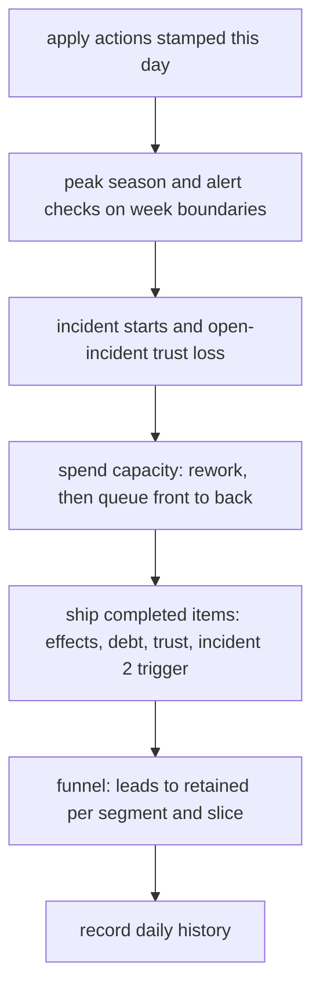

# Fix Forward Engine and Headless Mode - Plan

## Goal Capsule

- **Objective:** A team's 52-week product can be played start to finish with no server and no browser, and a team that does nothing stays at ₹25 Cr.
- **Means:** One deterministic daily engine over a single config module, driven by scripted teams (KTD1, KTD2).
- **Authority:** `fix_forward_build_spec_v3.md` wins on game rules. `CLAUDE.md` supplies defaults where the spec is silent. This plan wins on how the engine is built.
- **Stop conditions:** Stop and report if the do-nothing team drifts from ₹25 Cr, or if two spec rules cannot both hold in the engine. Do not redesign a mechanic.
- **Execution profile:** One change, no PR split. The directory is not a git repository, so there is no branch or PR step. Whoever runs the plan finishes and reports against the stage 1 "done when".
- **Out of this stage:** server, HTTP, clock, snapshots, browser screens, lift calibration, balance tuning, the eight named strategies.

---

## Product Contract

### Summary

Build `config.py`, `engine.py` and `bots.py` so the whole v3 mechanic set runs headless: funnel, slices, trust, hidden debt, quality mode, roadmap queue, reports, rollback, incidents, peak season, bespoke contracts and NEV scoring. Feature lifts are placeholders until stage 2 calibrates them.

### Problem Frame

Every later stage sits on the engine. Calibration needs it to solve lifts, the server needs it to step each team, and the consoles need a safe view of it. If it is not deterministic and cleanly separated from hidden values, each of those stages inherits the defect. The event is on 4 December and the build ends 23 November, so the engine has to be right the first time.

### Requirements

**Funnel and state**

- R1. Each team's product has three segments (Whales, Mid-Market, Self-Serve) with the spec's starting accounts, leads, conversion rates and churn, tracked as expected values with no randomness.
- R2. A do-nothing team holds ₹25 Cr ARR (₹10, ₹9 and ₹6 Cr by segment), trust 60 and UOD 0 on every day of all 52 weeks.
- R3. Every funnel stage can be cut by platform, plan and cohort slices of fixed share. A defect multiplies one stage in one slice, and the segment rate is the share-weighted result.
- R4. Weekly churn scales with trust (×(1 + 0.02 × (60 − trust))). UOD lowers activation and retention by 0.2% per point.

**Team actions**

- R5. Capacity is 8 BU a week minus 0.8 per delivered bespoke contract, spent through a reorderable queue. An item ships the day its cost is fully built. Removing a part-built item loses its BU.
- R6. Quality mode (Low, Medium, High) sets the share of capacity kept for features and the debt multiplier. A feature built across modes gets the BU-weighted average multiplier.
- R7. Cards unlock by quarter and follow the spec's table, including hidden risk, trust effects, once-per-quarter limits on P1 and P2, and a 4 BU segment report that reveals utility scores and churn alerts for the cards available when it was ordered.
- R8. Rollback takes effect after one week, uses no capacity, removes the feature's funnel effect, trust effect and debt, costs 3 target-segment trust, and makes re-shipping cost half. It is refused for bespoke contracts.

**Incidents, peak season, scoring**

- R9. Three incidents per team follow the spec's nine variants. Each damages one slice of one stage and costs the affected segment 2 trust a week while open.
- R10. A targeted fix, a rollback or a patch resolves an incident exactly as the spec's response table says, including wrong-cause and wrong-feature outcomes.
- R11. At the start of week 28 the platform holds or fails by UOD as the spec says. At the end of week 39 the two churn alerts fire if B2 or B3 has not shipped.
- R12. The five B1 slots go to the applicants with the highest Whale trust at the end of week 17. NEV follows the spec's formula.

**Determinism and visibility**

- R13. State is a pure function of config, seed and the action log. Replaying a log gives identical state.
- R14. Display metrics carry per-team seeded noise that never changes state. A separate team view omits every hidden value.
- R15. Every game number lives in `config.py`. The headless runner can run scripted teams over all 52 weeks and print a results table.

### Success Criteria

- The do-nothing run reports ₹25.000 Cr, trust 60 and UOD 0 at weeks 1 to 52.
- The engine test suite passes with the standard library only.
- A scripted team that queues cards runs to week 52 and produces a NEV.

### Scope Boundaries

**Deferred to Follow-Up Work**

- Lift calibration and the balance table (stage 2). The engine exposes a function stage 2 can drive.
- Server, clock, checkpoints, action-log file, snapshots (stage 3).
- The endpoint test that fetches every team URL for hidden fields (stage 3). Stage 1 delivers the team view and a test on it.
- Stakeholder bookings, script cards and the scored decline conversation (stage 6). The engine takes a decline result as an action but does not run the conversation.
- The eight named strategies (stage 2). Stage 1 ships only do-nothing and a smoke strategy.

**Considered and not built**

- Overtime, hiring, cash, shared markets, crowding, "deflect": rejected in `DECISIONS.md` section 1.3.
- Deep-copying state on every step for purity. The engine mutates state in place and purity is checked by replay (KTD3). A copy per step costs far more than it protects.
- A separate RNG stream for state. State has no randomness, so none is added.

---

## Planning Contract

### Key Technical Decisions

- KTD1. **State is a JSON-serializable dict mutated in place by `step` and `apply`.** Purity is the contract on `replay`, not on each call. Snapshots (stage 3) can then dump state directly. (session-settled: user-approved — chosen over a copy-per-step pure style: copies cost too much inside stage 2's bisection loops.)
- KTD2. **Build the full mechanic set now, with placeholder lifts.** Calibration then runs on the real engine and stage 5 does not reopen it. The lift for a card comes from one config table. Before calibration every card uses one placeholder value, and only the do-nothing run is checked against numbers. (session-settled: user-approved — chosen over funnel-only first: stages 2 and 5 would otherwise reopen the engine.)
- KTD3. **Time is days, one step per day.** `state.day` counts completed days. An action stamped day d is applied while `state.day == d`, in log order, before day d runs. Weekly flows are applied as one seventh per day. Week = day // 7 + 1. Quarters start on days 0, 91, 182 and 273.
- KTD4. **The team view is the only structure a browser may see.** It is built field by field from an allowlist, never by deleting hidden keys from state. Hidden names live in `config.HIDDEN_FIELD_NAMES`, which a test scans. (session-settled: user-approved — chosen over deferring all hidden-value work to stage 3: the contract is cheaper to set before the screens exist.)
- KTD5. **A defect is a record, not a rate edit.** It names segments, one stage, a slice spec (a map from dimension to slice) and a multiplier. The effect on a population is `1 − fraction × (1 − m)`, where fraction is the product of shares of the dimensions the spec names. The same function gives any slice's own multiplier, so segment rates and slice series agree. Incidents, regressions and the patch all use it.
- KTD6. **Display noise is a pure function of (seed, team, series, day).** It is hashed, not drawn from a shared generator, so reading a metric out of order cannot change another. The noise level is one config value stage 2 will tune.
- KTD7. **Cross-team resolution is a league function.** B1 awards need every applicant's Whale trust, so `resolve_b1_awards(states)` lives outside per-team `step`, and its result is applied to each team as a logged `award_bespoke` action.
- KTD8. **Defaults where the spec is silent** are in `config.py` and in `DECISIONS.md` Part 2 (see Assumptions). The `CLAUDE.md` defaults are used unchanged. (session-settled: user-approved — chosen over asking the organiser about each gap: the spec and `CLAUDE.md` are the only sources, and each default is logged for review.)

### Assumptions

Each is a gap the spec leaves open. The plan fixes a default so the engine can be built, and `DECISIONS.md` Part 2 records it. These are not confirmed with the organiser.

- A1. New cohort is 15% of each segment (the spec says "under 8 weeks" but gives no share).
- A2. UOD lowers retention by multiplying weekly churn by 1 + 0.002 × UOD. The literal reading (retention rate down 0.2% per point) would be an enormous weekly loss. Calibration revisits it.
- A3. The 0.8 BU bespoke tax starts when the contract ships, not when it is awarded.
- A4. C1 (Whale Beta) has no slot limit. The spec limits only B1.
- A5. Incident 2 counts the team's first shipped non-bespoke card with a target segment in weeks 15 to 24, so rollback stays possible. Incident 3 variant B damages the whole segment of the most recent such release. If there is no release, that incident does not trigger.
- A6. Variant letter = team number mod 3, with 0 mapped to A, 1 to B, 2 to C.
- A7. Incident 1 variant A damages Whale retention across all slices, B damages Self-Serve, and C damages all segments in the annual-plan slice. Variant C of incident 3 hits all segments in the web and new-cohort slices.
- A8. The quality capacity share applies to all queue work, including reports, fixes and patches. Debt accrues only from cards.
- A9. A fix, rollback or patch started during a pause takes effect only after resume, because nothing ships while paused. That is a server rule and does not change the engine.
- A10. Rework paid after a peak-season outage uses full weekly capacity, not the quality-adjusted share.

### High-Level Technical Design

Day loop for one team. Each box maps to one engine function, and none draws a random number.



Defect and slice maths, directional only:

```text
mult(defect, population) = 1 - frac * (1 - defect.m)
frac = product over dims named by defect.slice of
         (1 if population is that slice, 0 if it is another slice of that dim, share otherwise)
stage_rate = base * feature_lifts * uod_effect * product over defects of mult(...)
```

### Output Structure

```text
config.py            all numbers, cards, incidents, noise level, hidden field names
engine.py            new_state, apply, step, replay, score, team_view, resolve_b1_awards
bots.py              scripted strategies, headless runner, results table
tests/
  test_funnel.py
  test_queue.py
  test_incidents.py
  test_season_scoring.py
  test_determinism_view.py
DECISIONS.md         Part 2 rows for every assumption above
```

---

## Implementation Units

### U1. Config module

- **Goal:** Put every game number, card, incident definition and tunable in `config.py`, with a loader that engine and tests can override.
- **Requirements:** R15, R1, R7, R9.
- **Dependencies:** none.
- **Files:** create `config.py`; test `tests/test_funnel.py`.
- **Approach:**
  - Segment table from spec 3.1, slice shares from 3.2 plus A1, trust and UOD constants, quality-mode table.
  - The card table from spec section 5 as data: id, unlock quarter, name, cost, segment, stage, pitch, target gain, risk, trust effects, flags (bespoke, once per quarter, UOD change).
  - One lift table keyed by card id, filled from a single placeholder constant.
  - Incident definitions: start rule, symptom stage, variant to slice, true cause, candidate cause list.
  - Peak-season, alert, scoring, noise and `HIDDEN_FIELD_NAMES` constants.
  - `load(overrides)` returns an independent copy, so calibration changes lifts without touching the module.
- **Patterns to follow:** the data layout in `reference/v2_balance_sim.py` (`MENU`, `P`), widened to this spec.
- **Test scenarios:**
  - Starting ARR across segments sums to 25.0.
  - `load` returns a copy: changing a lift in one copy leaves the next `load` unchanged.
  - Every card in the spec table is present once, with the spec's cost and risk (spot check A1, B4, C3, D4, P1).
  - Slice shares per dimension sum to 1.
- **Verification:** the config imports with no side effects and every number the engine needs has a name.

### U2. Engine core: funnel, trust, UOD, daily step

- **Goal:** A team's state advances one day at a time and a do-nothing team holds still.
- **Requirements:** R1, R2, R3, R4, R13.
- **Dependencies:** U1.
- **Files:** create `engine.py` (state, funnel, defect function, `step`, `score`); test `tests/test_funnel.py`.
- **Approach:**
  1. `new_state(cfg, team_no, seed)` builds segments (accounts, ARR per account), trust 60, UOD 0, empty queue, empty defect list, day 0.
  2. A defect-effect function implements KTD5 and also returns a single slice's multiplier.
  3. The daily funnel computes new accounts and churn per segment from effective stage rates (feature lifts, UOD effect, trust scaling, defects) at one seventh of the weekly flow.
  4. `history` records per segment ARR, accounts and per-stage flows by slice for each day. It is true values only.
  5. `score` implements the NEV formula from spec section 8.
- **Execution note:** Write the do-nothing test first. The equilibrium is exact in theory, so any drift points at a rate or unit error.
- **Test scenarios:**
  - Do-nothing, 364 steps: every day's ARR is 25.0 within 1e-9, trust 60 and UOD 0 for all three segments.
  - At trust 40, weekly churn is 1.4 times the trust-60 value. At trust 80 it is 0.6 times.
  - UOD 50 cuts activation by 10%.
  - A defect on mobile only, multiplier 0.6 on activation, lowers segment activation by 0.4 × 0.4 = 16%, and the mobile slice's own multiplier is 0.6.
  - A two-dimension defect (web and new cohort) affects the product of both shares.
  - A defect on Whales leaves Mid-Market and Self-Serve untouched.
  - NEV for a hand-built state matches the spec formula, including the 2.0× bespoke valuation and the UOD and penalty terms.
- **Verification:** the do-nothing run holds ₹25 Cr for 52 weeks, which is the stage 1 done-when.

### U3. Queue, quality mode, cards, reports, rollback

- **Goal:** Teams can queue work, change quality mode, ship cards and reports, and roll shipped cards back.
- **Requirements:** R5, R6, R7, R8, R13.
- **Dependencies:** U2.
- **Files:** modify `engine.py`; test `tests/test_queue.py`.
- **Approach:**
  1. Actions: `queue_add`, `queue_remove`, `queue_reorder`, `set_quality`, `rollback`, `apply_b1`. Each returns `ok` or an error reason (card locked, already built, once-per-quarter limit, bespoke rollback).
  2. Daily capacity is (8 − 0.8 × delivered bespoke) / 7. The quality share (A8) goes to the front item, and any leftover after a ship flows to the next item the same day.
  3. Each item tracks BU built and the BU-weighted debt multiplier (KTD3 averaging). On ship, UOD rises by risk × average multiplier.
  4. Ship effects: apply the card's lift to its stage (leads, sign-up, activation, paid, retention, ARR per account), trust change, P1/P2/D4/D5 effects. B1 and C1 add bespoke ARR and start the capacity tax (A3).
  5. Reports resolve into a stored utility list, computed as round(100 × target gain ÷ pitch ARR), and the segment's churn alerts. The list is team-visible.
  6. Rollback is scheduled for one week later. On the effective day it removes the lift, trust effect and debt, applies −3 trust, marks the card re-shippable at 50% cost.
- **Patterns to follow:** none in this repo. The queue behaviour is spec section 4.
- **Test scenarios:**
  - A 20 BU card in Medium quality with 8 BU a week gets 0.9 × 8 / 7 ≈ 1.03 BU a day, so it completes during the 20th daily step, not the 18th (full capacity).
  - Reordering moves capacity to the new front item, and the paused item keeps its progress.
  - Removing an item that is half built loses its BU and adds none back.
  - A card built half in Low, half in High adds risk × 0.975 to UOD ((1.6 + 0.35) / 2), and switching to High only on the last day changes the average by that day's BU share alone.
  - Shipping a bespoke contract drops weekly capacity from 8 to 7.2.
  - The report for a segment shows `round(100 × gain ÷ pitch)` for each card then available, so AI Copilot shows 15, and omits cards unlocked later.
  - P1 queued twice in one quarter is refused the second time and accepted in the next quarter.
  - Rollback of a bespoke card is refused. Rollback of A2 restores the segment's activation and removes 5 Self-Serve trust, then applies −3, and re-queuing costs 10 BU.
  - Rollback does nothing until one week later.
- **Verification:** a scripted team that queues three cards sees them ship in order on the expected days with UOD matching risk × mode multiplier.

### U4. Incidents, targeted fix, patch, alerts, peak season

- **Goal:** Incidents start, hurt, and resolve per spec, and the week-28 and week-39 events fire.
- **Requirements:** R9, R10, R11, R13.
- **Dependencies:** U3.
- **Files:** modify `engine.py`; test `tests/test_incidents.py`, `tests/test_season_scoring.py`.
- **Approach:**
  1. Incident 1 starts at week 6, incident 3 at week 33, incident 2 on the ship day of the first qualifying card in weeks 15 to 24 (A5). Each adds a defect record per A7 and a tied `caused_by` card where relevant.
  2. Open incidents cost 2 trust a week to each affected segment.
  3. `targeted_fix(incident, cause)` queues a 15 BU item at the front and resolves on completion. A correct cause removes the defect and lowers UOD by 10 (floor 0). A wrong cause spends the BU and changes nothing.
  4. `patch(incident)` queues a 6 BU item at the front. On completion it halves the defect's damage, stops the trust loss and raises UOD by 15.
  5. Rollback resolves an incident only when the rolled-back card is the incident's `caused_by` card. Any other rollback still removes that card.
  6. Week 28 start: UOD ≤ 40 gives +5 trust everywhere. Above 40 sets rework owed to min(50, UOD − 30), seizes capacity until paid (A10), books the ₹3 Cr penalty, cuts Whale trust by 35, and lowers UOD by BU paid.
  7. End of week 39: Whale ARR −₹3 Cr (as accounts) and Whale trust −10 unless B2 has shipped and not been rolled back. Mid-Market trust −15 unless B3 has.
  8. Admin actions `trigger_incident`, `cancel_incident` and `admin_edit` (with reason) are accepted and logged so stage 3 can use them without changing replay.
- **Test scenarios:**
  - For each of the nine variants, the correct cause resolves it and the wrong cause leaves it open after the 15 BU are spent.
  - Incident 1 variant B damages Self-Serve only: Whale and Mid-Market metrics are unchanged.
  - A team that ships nothing in weeks 15 to 24 never gets incident 2.
  - Incident 2 starts on the ship day of the first qualifying card, not on a later one.
  - A patch halves a ×2 churn defect to ×1.5, stops the −2 trust a week, and adds 15 UOD.
  - Rolling back the caused-by card resolves incident 2. Rolling back another card loses that card and leaves the incident open.
  - UOD 40 holds with +5 trust. UOD 41 owes 11 BU, books ₹3 Cr, cuts Whale trust 35, and UOD falls by BU paid.
  - UOD 90 owes 50 BU (cap), not 60.
  - Without B2 shipped, week 39 ends with Whale ARR down ₹3 Cr and trust down 10. With B2 shipped, nothing happens.
  - A team with no qualifying release in weeks 15 to 24 and no release before week 33 gets no incident 3 variant B.
- **Verification:** all nine incident variants are resolvable from the engine's own action set and none requires hidden state to be exposed.

### U5. League awards, replay, admin actions

- **Goal:** Cross-team B1 awards work, and any action log replays to identical state.
- **Requirements:** R12, R13.
- **Dependencies:** U4.
- **Files:** modify `engine.py`; test `tests/test_determinism_view.py`, `tests/test_season_scoring.py`.
- **Approach:**
  1. `apply_b1` during weeks 14 to 17 records an application. Outside that window it is refused.
  2. `resolve_b1_awards(states)` at the end of week 17 picks the five applicants with the highest Whale trust. Ties break by lower team number, and the tie rule is logged.
  3. Winners get a logged `award_bespoke` action, which adds B1 to the queue. Losers lose nothing.
  4. A `decline_result` action (ticks 0 to 3) applies +5, 0 or −5 Whale trust.
  5. `replay(cfg, seed, team_no, log)` applies stamped actions and steps day by day, and a league variant replays several teams with the award hook.
- **Test scenarios:**
  - Seven applicants with distinct Whale trust: exactly the top five win, in all orders of application.
  - Two applicants tied at the fifth place: the lower team number wins.
  - An application on day 130 (week 19) is refused.
  - Replaying a recorded log of 30 mixed actions gives a state dict equal to the original after every day.
  - Applying the same log twice from `new_state` gives identical JSON.
  - A `decline_result` of 3, 2 and 1 ticks moves Whale trust +5, 0 and −5.
- **Verification:** a league of scripted teams runs to week 52 with logged awards and replays to the same final scores.

### U6. Telemetry and the team view

- **Goal:** Produce the metrics a console would show, with seeded noise, and a view that cannot leak hidden values.
- **Requirements:** R14.
- **Dependencies:** U5.
- **Files:** modify `engine.py`; test `tests/test_determinism_view.py`.
- **Approach:**
  1. Error rate = 0.5% + 0.04% × UOD, p99 = 300 ms + 6 ms × UOD (+200 ms while a platform-slowing incident is open, ×1.5 in weeks 28 to 30), tickets per segment = baseline × (1 + 0.03 × (60 − trust)) plus an incident bump. Each gets noise per KTD6.
  2. `team_view(cfg, state)` builds the visible structure from an allowlist: day, week, clock inputs, overview tiles (ARR, trust, capacity, open incidents), queue, quality mode, cards available with name, cost, segment, stage, pitch and trust effect, reports received, open incident symptoms, funnel series with noise, telemetry, release markers, B1 status.
  3. The view carries no true lifts, target gains, risk, UOD, NEV, incident cause or variant, and no other team's state.
  4. The noise level starts as one config value, to be tuned in stage 2.
- **Test scenarios:**
  - The same (seed, team, day) gives the same noise on every call. Two teams differ.
  - Calling `team_view` before, during or after a run leaves state byte-identical.
  - With noise set to zero, error rate equals 0.5% + 0.04% × UOD at UOD 0, 15 and 50.
  - p99 gains 200 ms while a platform-slowing incident is open and is ×1.5 in week 29.
  - The JSON of a team view, taken mid-game with an open incident and a report, contains none of the names in `HIDDEN_FIELD_NAMES`.
  - Utility scores in a received report appear (they are visible by design), while `target_gain` does not.
  - Sanity check: the same name scan on raw state does find hidden names, so the test is not vacuous.
- **Verification:** the hidden-name scan passes on the view and fails on raw state.

### U7. Headless runner and decision log

- **Goal:** Run scripted teams for 52 weeks, print a results table, and record the build decisions.
- **Requirements:** R15, R2.
- **Dependencies:** U6.
- **Files:** create `bots.py`; modify `DECISIONS.md` (Part 2); test `tests/test_funnel.py`.
- **Approach:**
  1. A strategy is a function from the team view and day to a list of actions, so it cannot read hidden state.
  2. `run_game(cfg, teams)` steps every team, calls the strategy once per simulated day, applies league awards, and returns weekly ARR, trust and final NEV.
  3. Ship `do_nothing` and one smoke strategy that queues a few cards in Medium quality. The eight stage 2 strategies are out of scope.
  4. `python bots.py` prints a table: strategy, ARR at weeks 26 and 52, trust, NEV.
  5. Append one `DECISIONS.md` Part 2 row per assumption A1 to A10 with date, reason, and "balance re-run: not applicable, stage 1".
- **Test scenarios:**
  - `run_game` with do-nothing reports ₹25.000 Cr at weeks 26 and 52 and NEV equal to 25 × (2.0 + 0.03 × 60).
  - The smoke strategy finishes with ARR above 25 and its action log replays to the same NEV.
  - A strategy cannot receive a view containing hidden names (reuses the U6 scan on the object passed in).
- **Verification:** the printed table shows the do-nothing row at ₹25 Cr for weeks 26 and 52.

---

## Verification Contract

| Check | Command | Passes when |
| :--- | :--- | :--- |
| Engine tests | `python -m unittest discover -s tests -v` | all tests pass, standard library only |
| Headless table | `python bots.py` | do-nothing shows ₹25.000 Cr at weeks 26 and 52 and the smoke strategy completes |
| No external packages | `python -c "import config, engine, bots"` (run from the project root) | imports succeed with no pip packages installed |

## Definition of Done

- Stage 1 "done when" holds: a do-nothing team stays at ₹25 Cr for all 52 weeks, shown by test and by the printed table.
- U1 to U7 each meet their verification line.
- Every rule in R1 to R15 maps to a passing test or the printed table.
- `DECISIONS.md` Part 2 has a row for each assumption A1 to A10.
- No file other than the layout in Output Structure was created, and no experimental or abandoned code is left in the files.
- The report to the organiser names the open assumptions, above all A2 (UOD effect on retention), A3 (when the bespoke tax starts) and A4 (C1 slots), because they change balance.

---

## Risks

- **Retention reading of the UOD rule (A2).** The literal reading is unplayable. The chosen reading may make debt too cheap, which stage 2 checks.
- **Equilibrium drift.** Floating-point error over 364 days could blur the do-nothing check. The test uses a 1e-9 tolerance, and the funnel adds and removes the same expression so equal flows cancel exactly.
- **Snapshot size later.** Per-day, per-slice history for 20 teams may be large for 5-second snapshots. History can be rebuilt by replay, so stage 3 may store it or skip it. Not decided here.

## Sources

- `fix_forward_build_spec_v3.md` sections 2 to 8 and 12 to 13.
- `CLAUDE.md` defaults table and hard constraints 1 to 7.
- `DECISIONS.md` Part 1, decisions 5, 6, 18, 19, 22, 25 and 26.
- `reference/v2_balance_sim.py` for the card table layout only.
