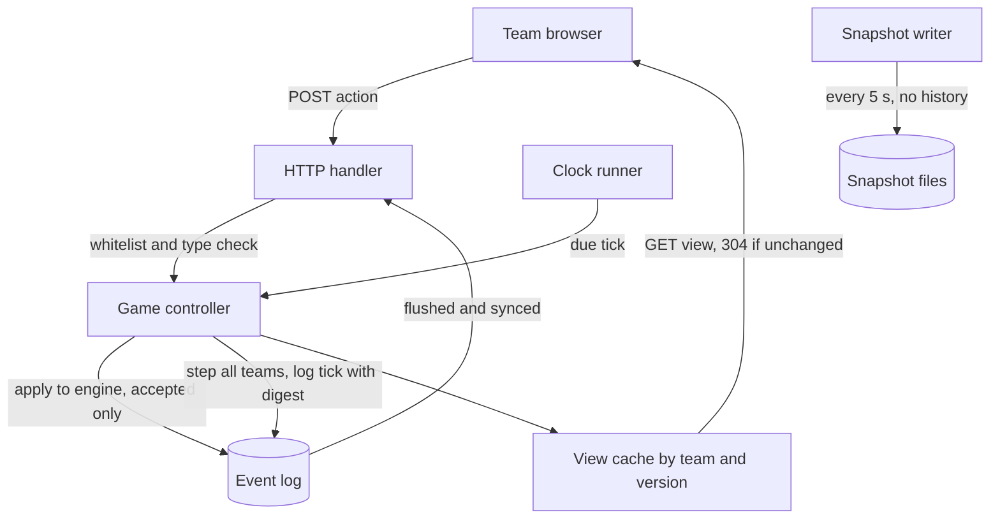
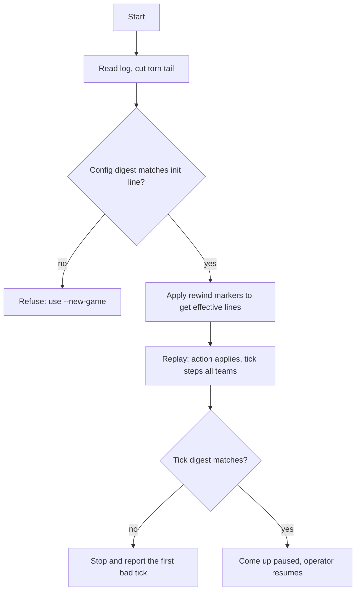

# Fix Forward Server, Clock and Durability - Plan

## Goal Capsule

- **Objective:** Fifteen or more teams can play the same 52-week game at once under one operator's control, and killing the server mid-game and restarting it loses no acknowledged action and no day.
- **Means:** One append-only event log that rebuilds every team's state by replay, a single server-side clock, and a thin HTTP layer that exposes only the engine's safe team view (KTD1, KTD3, KTD8).
- **Authority:** `fix_forward_build_spec_v3.md` sections 2, 9 and 10 and `CLAUDE.md` hard constraints win on rules. This plan wins on how the server is built.
- **Stop conditions:** Stop and report if replay cannot reproduce a live state, if a hidden field name appears in any team-facing response, or if recovery exceeds the 60-second budget.
- **Execution profile:** One change on a feature branch, one PR. Python standard library only.
- **Out of this stage:** browser screens, stakeholder endpoints and bookings, the scored decline conversation, spare-laptop replication, the emergency start from a bare snapshot, the 20-client load test and the failure drill. The balance plan at `docs/plans/2026-11-20-1552-feat-balance-resolution-plan.md` is separate and does not block this.

---

## Product Contract

### Summary

Add a server that runs every team's engine from one clock, records everything that changes state in one durable log, and serves team, projector and admin endpoints. The log is the source of truth, and a snapshot is a restore point written every five seconds.

### Problem Frame

The engine runs only inside a script today. On 4 December one operator must control the clock for every team, nothing a team does may touch another team's state or the clock, and a crash or restart must not lose a team's work. The spec requires an action log, atomic snapshots, an admin pause and a restart that rebuilds state in under a minute. Research before this plan found that the engine's state round-trips through JSON without changing the outcome, that replaying a whole game takes about 0.07 s per team, and that three Windows and crash hazards (a blocked snapshot swap, a torn final log line, and a coarse 15 ms clock) need explicit handling.

### Key Decisions

- **Everything that changes state is appended to one log, and replaying it alone rebuilds the game.** Each day tick, accepted action, admin action, clock operation and reveal is a log line, and each tick carries a state digest. Governs R5, R6, R9. (session-settled: user-approved — chosen over snapshot plus a log tail: replay of a full game is seconds and a digest catches divergence at restart.)
- **Snapshots leave out per-day history.** History is about 1 MB per team by the end of the game and would make every 5-second write tens of MB. Governs R7. (session-settled: user-approved — chosen over full-state snapshots: 100 KB against about 17 MB per write.)
- **The server restarts paused and the operator resumes.** Governs R6. (session-settled: user-approved — chosen over resuming the clock automatically: an unattended clock on a restored state is the worse failure.)
- **Restoring a snapshot appends a rewind marker and keeps the log intact.** Governs R7. (session-settled: user-approved — chosen over truncating the log: the record of what happened stays, and replay still works.)
- **Polls are served from a per-team cache and a short default window.** The full team view is 0.38 MB and 22 ms, and 1.5 MB and 91 ms with slices. Governs R12. (session-settled: user-approved — chosen over serving the full view every poll: 20 teams every 3 seconds would use most of a core.)
- **Team codes are saved with the game state, and passwords are given at startup and never stored.** Governs R10. (session-settled: user-approved — chosen over regenerating codes on restart: a restart must not lock teams out.)
- **A mid-game number change is refused.** The log's first line records a digest of the config, and a restart with a different digest stops with a message. Governs R8.

### Requirements

**Clock and time**

- R1. One server clock steps every team together, one simulated day per `SECONDS_PER_DAY` at the chosen speed, and consoles only display what the server reports.
- R2. At the end of weeks 13, 26 and 39 the game pauses automatically with a 420-second countdown, a warning in the last 30 seconds, and an automatic resume at zero unless the operator holds. Nothing steps while paused, and teams may still submit actions.
- R3. The operator can pause, resume, extend, hold, override the countdown and change speed, and every clock operation is logged.
- R4. The game starts paused at day 0 and stops at day 364, and a stalled server never fast-forwards to catch up.

**Durability**

- R5. An action is acknowledged only after its log line is on disk. If a log line cannot be written, the game pauses and actions are rejected.
- R6. Restart rebuilds every team's state from the log, drops a torn final line, verifies each tick's digest, refuses to continue on a mismatch, and comes back paused.
- R7. A snapshot of every team's state without history is written atomically every 5 seconds with bounded retention, and the operator can restore one, which rewinds the log and is verified by its digest.
- R8. A restart whose config differs from the one recorded at game start is refused, and `--new-game` archives the old state and starts clean.
- R9. Killing the process at any moment loses no acknowledged action and no completed tick.

**Access and safety**

- R10. Teams are identified by a random six-character code that is saved with the game, a team can act only as itself, and admin and stakeholder passwords are set at startup and compared in constant time.
- R11. Team endpoints return only the engine's team view plus the clock. Teams may submit only the action types a team is allowed, with field types checked before the engine sees them, and invalid input changes nothing and writes nothing.
- R12. A team's default view stays under 60 KB and 10 ms, and an unchanged poll returns not-modified.
- R13. A public projector endpoint returns each team's ARR, trust and rank and the clock, and adds debt and valuation only after the operator's final reveal.
- R14. Admin endpoints cover pause, resume, speed, extend, hold, countdown override, trigger or cancel an incident for one team or all, edit a team's state with a logged reason, list and restore snapshots, final reveal, and a status report with team codes and log health.
- R15. At the end of week 17 the five B1 awards are decided across teams and logged as system actions.
- R16. The server binds to `0.0.0.0` on a configurable port, serves static files from `static/` without path traversal, and every URL it hands out is relative.

### Success Criteria

- A process killed with no warning and restarted returns every team to the state its last logged tick and actions imply, verified by digest, and the game resumes on the operator's command.
- A scan of every team-facing response finds none of the names in `HIDDEN_FIELD_NAMES`.
- Recovery of a full 364-day, 16-team game finishes in under 60 seconds.

### Scope Boundaries

**Deferred to Follow-Up Work**

- Browser screens for teams, projector, stakeholder and admin (stages 4 to 6).
- Stakeholder endpoints: bookings, CTO debt bands, decline checklist (stage 6).
- Spare-laptop replication of the state directory and the emergency start from a bare snapshot (stage 7).
- The 20-client load test and the failure drill (stage 7).

**Considered and not built**

- Rate limiting and lockout. The server runs on a private network and a team needs another team's code to act as it. Evidence that would change the call: a team found scripting requests against the admin or other teams' endpoints.
- Cookie sessions, websockets or HTTPS. The spec fixes 3-second polling and the network is local.
- A database. One log file and a few snapshot files cover the need.
- Letting an acknowledged action be lost for speed. The measured cost of forcing each line to disk is 3.3 ms.

---

## Planning Contract

### Key Technical Decisions

- KTD1. **The log is JSON lines with a running sequence number.** Kinds are `init`, `tick`, `action`, `clock` and `system`. Replay applies them in order: an `action` is applied at the current day, and a `tick` steps every team one day. A `rewind` system line drops every earlier line with a higher sequence number from the effective list, so restore never rewrites history.
- KTD2. **A tick line carries a digest of every team's state without history.** Recovery recomputes the digest after each replayed tick and stops with a clear message on the first mismatch. The digest function lives in the engine so it cannot drift from the state shape.
- KTD3. **An action is applied, then logged, then acknowledged, all under one lock.** Only actions the engine accepts are logged. If the log write fails after an apply, the server pauses, marks itself degraded, and the response is an error. The unacknowledged change is discarded by the next restart, which is correct because the caller was never told it succeeded.
- KTD4. **The server whitelists and type-checks actions before calling the engine.** The engine's `apply` accepts admin types and raises on malformed fields, so a table in config lists, per caller kind, which action types are allowed and each field's type, and nothing outside it reaches the engine.
- KTD5. **The clock is a small state machine with injectable time.** It takes the current time as an argument and returns what to do, so tests drive it with a fake clock and the 15.6 ms resolution of the Windows monotonic clock never matters. After each tick the next tick is scheduled a full interval ahead, never as a catch-up.
- KTD6. **The first log line records the seed, the team numbers and a config digest.** Replay uses the recorded seed and teams, and a changed config stops the start, so a number tuned during rehearsal cannot silently change a live game.
- KTD7. **Snapshot writes retry on a blocked swap and never stop the game.** A failed `os.replace` is retried briefly and then skipped with a warning shown in the admin status, and the previous snapshot stays. Readers get a copy made in memory and never hold the snapshot file open.
- KTD8. **On startup the log's last line is validated, and a torn tail is cut off before anything is appended.** Otherwise the next append would glue onto the fragment and corrupt two lines.
- KTD9. **The view cache is keyed by team and a version counter.** A team's version changes on a tick, an accepted action or an admin edit to that team. The default response is the last `VIEW_DEFAULT_SERIES_DAYS` days without slices, and the full series and slice detail are opt-in query parameters.
- KTD10. **The B1 award is a system action.** At the tick where the end of week 17 is reached, the league resolver picks winners from live state and each winner receives a logged `award_bespoke` action, so single-team replay reproduces it.

### Assumptions

- A1. The default is 16 teams, numbered 1 to N, because the team number picks the incident variant. Names default to "Team N" and are editable in the saved registry file.
- A2. Passwords come from `FF_ADMIN_PASSWORD` and `FF_STAKEHOLDER_PASSWORD` or a startup flag, and are generated and printed once if absent.
- A3. One game seed comes from config and is recorded in the log. Display noise still differs by team number.
- A4. A restart during a checkpoint countdown comes back paused with no countdown, and the operator resumes by hand.
- A5. A fix, patch or rollback submitted while paused takes effect after resume, because nothing steps while paused. The engine already behaves this way.
- A6. Replication to the spare laptop copies the whole state directory, log included, so history survives takeover. Stage 7 builds it.

### High-Level Technical Design

Runtime path. Everything that changes state goes through one lock and one log.



Recovery path.



### Output Structure

```text
config.py            server, clock, snapshot, action-whitelist and cache settings
engine.py            adds state_digest
clock.py             clock state machine with injectable time
store.py             event log, torn-tail repair, snapshots, team registry
game.py              controller: teams, tick, actions, admin operations, recovery, restore
server.py            HTTP layer, auth, view cache, static files, runner threads, startup
tests/
  test_clock.py
  test_store.py
  test_game.py
  test_recovery.py
  test_server.py
  test_kill_restart.py
```

---

## Implementation Units

### U1. Server settings and state digest

- **Goal:** Put every server number in config and give the engine a digest of team state.
- **Requirements:** R1, R2, R7, R10, R11, R12.
- **Dependencies:** none.
- **Files:** modify `config.py`, `engine.py`; test `tests/test_funnel.py`.
- **Approach:**
  1. Add settings for port, bind host, state directory, team count and code alphabet and length, seconds per day, speed choices, checkpoint weeks, countdown and warning seconds, snapshot interval, retention and swap-retry counts, fsync switch, view window days, request size cap, poll interval hints, and the recovery time budget.
  2. Add the per-caller action table: allowed types and each field's type, with team, admin and system callers.
  3. Add `state_digest(cfg, state)` to the engine: a hash of the JSON of the state without `history`, with sorted keys.
- **Test scenarios:**
  - The digest is equal for two states that differ only in `history`, and differs when any trust value differs by one unit in the last place.
  - The digest of a state reloaded from JSON equals the digest of the original.
  - Every config key the server reads exists with a default.
- **Verification:** the digest is stable across a JSON round trip and ignores history.

### U2. Durable store

- **Goal:** Append events safely, read them back after a crash, and write snapshots atomically.
- **Requirements:** R5, R6, R7, R9.
- **Dependencies:** U1.
- **Files:** create `store.py`; test `tests/test_store.py`.
- **Approach:**
  1. An event log object appends one JSON line with the next sequence number, flushes, and forces it to disk unless the config switch is off. It reports failure to the caller instead of swallowing it.
  2. Reading returns all complete lines in order. A last line that is not valid JSON is dropped, and the file is truncated to the last newline before any append.
  3. A function turns the lines into the effective list by applying `rewind` markers (KTD1).
  4. A snapshot writer writes to a temporary file, forces it to disk, and swaps it in with a bounded retry on a blocked swap. It keeps the most recent N snapshots and the first snapshot of each game week, and lists them with sequence number, day and digest.
  5. The team registry is a small JSON file read at startup and written once.
- **Test scenarios:**
  - Append 1,000 lines, reopen, and read them back in order with continuous sequence numbers.
  - A file ending in half a line returns the good lines, truncates the fragment, and the next append lands on its own line.
  - A rewind marker to sequence 40 removes lines 41 and above that came before it and keeps later lines.
  - When the swap raises `PermissionError` three times and then succeeds, the snapshot is written. When it never succeeds, the writer reports failure and the previous snapshot is unchanged.
  - Retention keeps exactly the configured number of recent snapshots plus one per game week.
  - A simulated write failure surfaces as an error from append.
- **Verification:** a log cut at any byte offset reads back to the last complete line.

### U3. Clock state machine

- **Goal:** Decide when the next day runs and when pauses start and end.
- **Requirements:** R1, R2, R3, R4.
- **Dependencies:** U1.
- **Files:** create `clock.py`; test `tests/test_clock.py`.
- **Approach:**
  1. State: running or paused with a reason (start, operator, checkpoint, restart, degraded, finished), day, speed, next tick time and countdown end.
  2. A single method takes the current time and returns the events it caused (a tick due, a checkpoint pause begun, an automatic resume).
  3. Operator operations are pause, resume, extend, hold, set countdown and set speed, each returning the event to log.
  4. After a tick the next tick is one interval ahead of now, with no catch-up.
  5. A status method reports day, week, running state, reason, speed, seconds to next tick, countdown remaining and whether the 30-second warning is on.
- **Test scenarios:**
  - At 13 s per day and speed 1, advancing 13 s ticks once and 26 s ticks twice, one at a time.
  - After a 10-minute stall the clock ticks once, not 46 times.
  - Completing day 91 pauses with reason checkpoint, a 420 s countdown and warning off, then warning on at 30 s remaining, then an automatic resume at 0.
  - Hold on a checkpoint pause removes the automatic resume, and extend adds to a live countdown.
  - Speed 2 halves the interval, and an unknown speed is refused.
  - The game stops after day 364 with reason finished.
  - A new clock starts paused at day 0.
- **Verification:** the clock tests run with a fake clock and no sleeping.

### U4. Game controller

- **Goal:** Hold every team's state and apply every state change under one lock, through the log.
- **Requirements:** R1, R5, R10, R11, R15.
- **Dependencies:** U2, U3.
- **Files:** create `game.py`; test `tests/test_game.py`.
- **Approach:**
  1. Create the teams from the registry with the recorded seed, and write the `init` line on a new game.
  2. A team action is checked against the whitelist table and field types (KTD4), applied, and logged only if the engine accepted it, in that order (KTD3). A log failure pauses the clock and marks the game degraded.
  3. A tick steps every team, runs the B1 award hook on the right day (KTD10), logs the `tick` line with the digest, and bumps every team's version.
  4. Admin operations (incident trigger or cancel for one team or all, edit with a reason, reveal) go through the same path with source `admin` and are logged.
  5. `view(team, window, slices)` and `projector()` build responses from engine views and bump nothing.
- **Test scenarios:**
  - A team submitting `award_bespoke`, `admin_edit`, `trigger_incident` or `decline_result` is refused and nothing is logged.
  - Malformed fields (a list for a card, a string for a position, a boolean for an item, an unknown key, a 10 KB string) are refused without an exception, and nothing is logged.
  - A refused engine action (locked card) is returned to the caller and not logged.
  - When the log append raises, the response is an error, the clock is paused with reason degraded, and later actions are rejected until the operator clears it.
  - Three teams stepped for 130 days: B1 applicants from weeks 14 to 17 are resolved at the end of week 17, and the five highest Whale trust receive logged `award_bespoke` lines.
  - An admin edit without a reason is refused. With a reason it is applied and logged.
  - Admin trigger for "all teams" opens the incident in every team.
  - The projector response has no debt or valuation fields before reveal and has them after.
- **Verification:** every state change in a controller test has exactly one log line.

### U5. Recovery and restore

- **Goal:** Rebuild the game from the log after any stop, and rewind it on the operator's command.
- **Requirements:** R6, R7, R8, R9.
- **Dependencies:** U4.
- **Files:** modify `game.py`, `store.py`; test `tests/test_recovery.py`.
- **Approach:**
  1. Startup reads the log, repairs the tail, checks the config digest in the `init` line, builds the effective line list, and replays it into fresh team states.
  2. After every replayed tick the digest is recomputed and compared. The first mismatch stops the start with the tick number and the teams that differ.
  3. The clock comes up paused with reason restart, the last speed restored from the log.
  4. A snapshot writer thread body saves every team's state without history, plus sequence number, day, digest, clock status and reveal flag, at the configured interval when the sequence number has moved.
  5. Restore pauses the clock, appends a `rewind` marker for the chosen snapshot's sequence number, rebuilds states by replay, and checks the result against the snapshot's digest. A mismatch undoes nothing and reports an error.
  6. `--new-game` moves the existing state directory aside under a timestamped name.
- **Test scenarios:**
  - After 200 days with mixed actions, rebuilding from the log gives team states whose digests equal the live ones at every tick.
  - A log whose last line is cut mid-write recovers to the previous line with no error.
  - Flipping one digit in a tick's digest stops recovery and names that tick.
  - Starting with a different config digest is refused with a message naming `--new-game`.
  - Recovery restores speed and reveal, the registry codes are unchanged, and the clock is paused.
  - Restoring the snapshot from day 90 after running to day 120 returns every team's digest to the snapshot's, and a later restart replays to the same state.
  - Full recovery of 16 teams over 364 days takes under the configured budget.
- **Verification:** replay equals live state at every tick for a full game.

### U6. HTTP layer: teams, projector, static

- **Goal:** Serve the team and public screens' data and static files safely.
- **Requirements:** R10, R11, R12, R13, R16.
- **Dependencies:** U5.
- **Files:** create `server.py`; test `tests/test_server.py`.
- **Approach:**
  1. A threading HTTP server on the configured host and port, a handler that parses a small route table, and JSON responses with a size cap on request bodies.
  2. Team routes under `/api/team/<code>/`: `view` (window and slices parameters, ETag from the team version) and `action`. A wrong code is the same not-found response for every wrong code.
  3. Public routes: `/api/clock` and `/api/projector`.
  4. Static files from `static/` with a path check that rejects anything resolving outside it.
  5. Startup parses flags (port, state directory, teams, seconds per day, new game, passwords), prints the team codes and admin and stakeholder passwords once, and starts the clock runner and snapshot threads.
  6. Responses carry the poll interval hints from config so the browser never hard-codes them.
- **Test scenarios:**
  - A real server on an ephemeral port: a valid code returns a view with the clock block, an unknown code returns 404, and the response bodies of the two failures are identical.
  - A repeated poll with the returned ETag gets 304, and after a tick it gets a full response.
  - The default view is under 60 KB, and 100 consecutive default views average under 10 ms.
  - `../config.py`, an encoded `..%2f` and an absolute path are refused by the static handler.
  - A POST with a body over the cap is refused with no state change.
  - The projector response lists every team and the clock and none of the hidden names before reveal.
  - A team posting an action as another team's code is acting as that code's team only.
- **Verification:** the hidden-field scan (U8) passes on every route this unit adds.

### U7. Admin endpoints

- **Goal:** Give the operator every control the spec lists.
- **Requirements:** R3, R7, R10, R14.
- **Dependencies:** U6.
- **Files:** modify `server.py`, `game.py`; test `tests/test_server.py`.
- **Approach:**
  1. Admin routes under `/api/admin/` check the admin password header in constant time.
  2. Routes: clock (pause, resume, speed, extend, hold, set countdown), incident (trigger or cancel, one team or all), edit (team, path, value, reason), snapshots (list), restore, reveal, status.
  3. Status returns the clock, log sequence and health, last snapshot age and any warning, and each team's number, name and code.
- **Test scenarios:**
  - A request with no password or a wrong password gets 401 and changes nothing, and the team and stakeholder passwords do not open admin routes.
  - Pause, resume, speed and extend each change the clock status and add one log line.
  - Incident trigger with `all` opens the incident for every team, and cancel removes it.
  - An edit without a reason is refused, and with one it changes the field and logs the reason.
  - Reveal makes the projector show debt and valuation, and a restart keeps it revealed.
  - Restore of a listed snapshot pauses the game and rewinds, and an unknown snapshot id is refused.
  - Status shows a snapshot warning after a simulated failed snapshot swap.
- **Verification:** every admin route has a test for a missing password.

### U8. End-to-end durability and visibility

- **Goal:** Prove the stage's done-when with a real process and a scan of every response.
- **Requirements:** R6, R9, R11, R12, R16.
- **Dependencies:** U7.
- **Files:** create `tests/test_kill_restart.py`; modify `tests/test_server.py`.
- **Approach:**
  1. Start the real server as a subprocess with a very short day length, post actions from a test client, let it run past a checkpoint, kill the process without warning, restart it, and compare.
  2. Build a mid-game state with an open incident, a received report and a queued item, then request every team route and scan the keys of every response.
- **Execution note:** Write the kill test first. It is the stage's done-when, and it exposes any ordering mistake between apply, log and acknowledge before anything else is built on it.
- **Test scenarios:**
  - Every action acknowledged before the kill is present after restart, and the restored digests equal an in-process replay of the log.
  - After restart the server is paused, resuming it advances from the restored day, and no day is skipped or repeated.
  - A kill during a burst of actions from several client threads loses none that were acknowledged.
  - The key scan of the view (default, full and with slices), the action response, the clock route and the projector finds no name in `HIDDEN_FIELD_NAMES`.
  - The scan is not vacuous: the same scan of raw engine state finds hidden names.
- **Verification:** the kill-and-restart test passes ten times in a row.

---

## Verification Contract

| Check | Command | Passes when |
| :--- | :--- | :--- |
| All tests | `uv run python -m unittest discover -s tests` | stages 1 to 3 pass |
| Kill and restart | `uv run python -m unittest discover -s tests -p "test_kill_restart.py"` | passes ten consecutive runs |
| Server smoke | `uv run python server.py --teams 3 --seconds-per-day 0.2 --new-game` | prints team codes and starts; `/api/clock` answers |
| Standard library only | `uv run python -c "import config, engine, clock, store, game, server"` | imports succeed with no dependencies |

## Definition of Done

- A process killed without warning and restarted loses no acknowledged action and no day, shown by the kill test.
- Replay equals live state at every tick for a full game, and recovery finishes inside the configured budget.
- No team-facing response contains a name in `HIDDEN_FIELD_NAMES`.
- Every admin route rejects a missing or wrong password, and every action type outside the whitelist is rejected.
- A mid-game config change is refused at startup.
- U1 to U8 each meet their verification line, and no abandoned code remains.

---

## Risks

- **Windows file behavior.** The snapshot swap fails if anything holds the old file open, which KTD7 handles by retrying and never stopping the game. Antivirus scanners can cause the same failure.
- **Lock contention.** One lock serves ticks, actions and view builds. Default views take about 2 ms and the full view about 22 ms, so the lock is held briefly, but a flood of full-view requests could delay a tick. The cache and default window are the mitigation, and stage 7's load test is where it is confirmed.
- **Digest cost.** A digest per tick over 16 teams is about 100 KB of JSON hashed once a day, and cheap. If a later change grows the state, this is the first place to look.
- **Log growth and file handles.** A game writes a few thousand lines. Long idle connections are not a concern because polling uses short requests.
- **Operator error.** Resuming after a restart, and using `--new-game` between rehearsals, depend on the operator. The admin status screen and the startup message must make both obvious, and the stage 7 failure drill should rehearse them.

## Sources

- `fix_forward_build_spec_v3.md` sections 2 (time model), 9 (stakeholders), 10 (software and resilience).
- `CLAUDE.md` hard constraints 3 to 7 and the polling, auth and snapshot defaults.
- `engine.py` `new_state`, `apply`, `step`, `replay`, `team_view`, `resolve_b1_awards`; `bots.py` `run_game` for the tick and award order.
- Pre-plan measurements on 20 to 23 November 2026: snapshot size with and without history, view size and cost, one-team replay time, JSON round-trip identity, fsync cost per line, blocked `os.replace` on Windows, torn-line handling.
