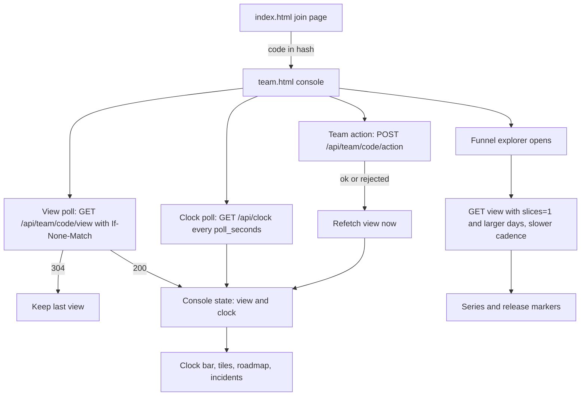

# Fix Forward Team Console - Plan

## Goal Capsule

- **Objective:** A person on a team laptop can play Q1 (weeks 1 to 13) of Fix Forward end to end in a browser, reading the funnel, steering the roadmap and responding to the week-6 incident, in an interface that feels like a polished modern SaaS product, while seeing only what a team is allowed to see.
- **Means:** A Vite, React, TypeScript, Tailwind and shadcn/ui project in `web/` that compiles into the existing `static/` directory, polls the existing team endpoints, and is committed as built output so the event laptops need only Python (KTD1, KTD2, KTD4).
- **Authority:** `fix_forward_build_spec_v3.md` (sections 3, 4, 6.3, 10.2, 12) wins on game rules. `CLAUDE.md` hard constraints win except constraints 1 and 2 (no Node, no frameworks), which the user overrode for the front end only; U3 amends that file. This plan wins on how the console is built.
- **Stop conditions:** Stop and report if any team-facing response gains a hidden field name, if the built console makes a request to any host other than the server that served it, or if Q1 cannot be played to the week-13 checkpoint.
- **Execution profile:** One change on `feat/team-console`, one PR. Python standard library only at runtime. Node is a build-time tool only.
- **Out of this stage:** projector, stakeholder and admin screens, the operations telemetry panel, stakeholder booking, peak-season views, bespoke contract ranking, the 20-client load test and the failure drill.

---

## Product Contract

### Summary

Add the team console: one page per team, opened with the team's code, with a clock bar, a four-tile overview, a roadmap with a draggable queue and quality control, segment reports, a funnel explorer with slice filters and release markers, and an incident panel with the response actions. It is a light-theme interface styled after the reference site the user built, and it reads only the fields the server already sends to a team.

### Problem Frame

Teams cannot play yet. The engine, clock and durable server work, but `static/` is empty, so nobody can queue work, set quality or read the funnel. The event is on 4 December, the three-team live quarter is 24 to 26 November, and the spec's day-4 done condition is that a person can play Q1 end to end. Incident 1 starts in week 6, inside Q1, so a console that only displayed it would leave a team unable to act on it. The user asked for a SaaS-quality light interface rather than plain HTML, which the project's hard constraints forbade, so this stage also records that exception.

### Key Decisions

- **The console includes the incident alert and the response actions (targeted fix, patch, rollback).** Governs R8. (session-settled: user-approved — chosen over showing only the alert and leaving responses to stage 5: incident 1 lands in week 6 of Q1, so Q1 would not be playable. The server already accepts these actions.)
- **Report utility scores come from each card's calibrated gain, not its target gain.** Governs R12. (session-settled: user-approved — chosen over keeping target gains: cards B2, B3 and C4 cannot reach their targets, so reports overstate them.)
- **Operations telemetry (error rate, latency, tickets) is left to stage 5.** Bounds this stage's scope (see Scope Boundaries). (session-settled: user-approved — chosen over building it here: it is not needed to play Q1 and the funnel explorer is the larger piece.)
- **The look follows the reference site's style, not its branding.** Governs R10. (session-settled: user-directed — chosen over an unstyled or hand-drawn interface: the user wants a clean, light, SaaS-quality feel, and named https://dropshipping-marketplace.vercel.app/ as the reference.)

### Requirements

**Access and clock**

- R1. A team opens the console at a relative URL, enters or follows its six-character code, and sees only the data returned for that code.
- R2. A clock bar shows the server's day, week, quarter, running or paused state with its reason, next checkpoint, countdown with its warning, and a finished state, taken from the server's clock block only.
- R3. Losing the connection, a 503 from the server, or an unknown code shows a clear banner or returns to the join screen, and the last good view stays on screen during a connection loss.

**Overview and roadmap**

- R4. The overview shows exactly four tiles (ARR, trust, build capacity, open incidents). Everything else sits one click down. Whale figures appear as ARR, never as account counts.
- R5. The roadmap lists every card unlocked so far with its cost, segment, stage, pitch ARR, trust effect and status, and a team can add a card to the queue.
- R6. The queue shows each item's progress and lets a team reorder it by drag or keyboard and remove an item, warning first that removing a partly built item loses the work already spent.
- R7. A team can set quality mode at any time, and the current mode is always visible. The console shows mode names with qualitative descriptions and no game numbers.
- R8. A team can order a segment report, read each report's utility scores and alerts, and, when an incident is open, see its symptom, affected metric and candidate causes and respond with a targeted fix, a patch, or a rollback of a shipped card.

**Funnel explorer**

- R9. The funnel explorer charts a chosen funnel stage as a daily series, filtered by segment, platform, plan and cohort, with a marker on every release. Slice data loads only while the explorer is open.

**Presentation and delivery**

- R10. The interface is a light theme with a restrained SaaS look, self-hosted fonts and no request to any external host, and it works at laptop widths and degrades usably at tablet width.
- R11. The built console is committed in `static/` and served by the existing server, `python3 server.py` runs without Node or internet, and every URL is relative.
- R12. Report utility scores derive from calibrated gains, and the balance league is re-run with before and after results recorded.
- R13. No hidden field reaches a team's browser: the existing endpoint test stays the gate, and the console reads only fields `engine.team_view` already returns.

### Success Criteria

- A person plays weeks 1 to 13 in the browser pane against a fast server, queues and reorders work, switches quality, resolves incident 1 from the funnel data, and reaches the week-13 checkpoint without touching a terminal.
- Steady-state polling stays at the light-view size, and an unchanged team costs a 304 rather than a body.

### Scope Boundaries

**Deferred to Follow-Up Work**

- Operations telemetry panel (stage 5), peak-season banner and views, bespoke contract ranking display, stakeholder booking (stage 6).
- Projector, stakeholder and admin screens, which will reuse the components built here.
- Tuning how often the explorer refreshes its large view, which the stage 7 load test decides.

**Considered and not built**

- Browser end-to-end tests: the repo has no browser test setup and the Q1 playthrough in Verification covers the flows; a recurring regression would change this.
- A guard that the committed build matches the source: no CI exists, a stale bundle is visible on first load, and a rebuild is one command, so a README rule is enough.
- Ticking the countdown locally between polls: it would be a console-side timer, which hard constraint 6 forbids (see Open Questions).
- Dark mode and translations.

---

## Planning Contract

### Key Technical Decisions

- KTD1. **Build the console with Vite, React, TypeScript, Tailwind v4 and shadcn/ui in `web/`, compiled into `static/` and committed.** Node runs on a development machine only, and the compiled files are what the server serves, so an event laptop or the spare laptop needs only Python. (session-settled: user-directed — chosen over plain HTML, CSS and JS: the user wants a SaaS-quality light interface and named shadcn, Node and Tailwind.) Cited by U3 to U8.
- KTD2. **Use Vite's multi-page build with one HTML entry per screen and shared components, and set the base path to relative.** The server has no single-page fallback and each screen is its own URL, so `index.html` (join) and `team.html` are entries now, and projector, admin and stakeholder join later. Relative base keeps hosting undecided. Cited by U3.
- KTD3. **The team code travels in the URL hash and is remembered in `localStorage` as a convenience.** A hash is never sent to the server, so codes stay out of request logs, and a shared link opens a team's console directly. The join page at `/` redirects to `team.html#<code>`. Cited by U3, U4.
- KTD4. **Poll the view with `If-None-Match` and poll the clock separately, both at the interval the clock block reports.** A 304 carries no body and therefore no clock block, so the countdown would go stale on an idle team if it rode only on the view. Two small requests every 3 seconds per team is about 13 requests per second at 20 teams. Intervals are never hard-coded. Cited by U4, U5.
- KTD5. **The funnel explorer asks for the heavy view (`slices=1`, a larger `days` window) when it opens, and refreshes it on a slower cadence than the light view.** The full view with slices is about 1.5 MB, and 20 teams re-fetching it every 3 seconds would be about 10 MB/s on venue Wi-Fi. The cadence is a multiple of the poll interval, paused while the tab is hidden, and tuned in stage 7. Cited by U7.
- KTD6. **Actions are sent, then the view is refetched immediately; the console does not guess outcomes.** The server validates and may reject, and the engine decides item ids and progress. A pending state disables the control, and a rejection shows the server's message. Cited by U4, U6, U8.
- KTD7. **Charts use shadcn's chart component over Recharts, with release markers as vertical reference lines.** The component wraps Recharts v3 and gives tooltips and theming that match the rest of the interface. Cited by U7.
- KTD8. **Queue reordering uses `@dnd-kit/sortable` with a keyboard sensor and sends `queue_reorder` with the item id and the target index.** It gives drag, touch and keyboard operation without writing the interaction by hand. Cited by U6.
- KTD9. **Design tokens live as CSS variables in one stylesheet, light theme only, with Inter for text, a monospace for small uppercase eyebrow labels and a serif for large titles and key numbers.** Fonts are installed from Fontsource packages and bundled, so nothing loads from a CDN. The reference site's pattern is white pages, near-black text, hairline borders, pill buttons and soft grey cards with large radii. Cited by U3, U5.
- KTD10. **Report utility uses a calibrated-gain table loaded with the config, falling back to the card's target gain when a card has none.** `calibration/lifts.json` already records an achieved gain for every card, equal to the target for solved cards and lower for B2, B3 and C4. Placeholder-lift test runs keep target gains. Cited by U1. (session-settled: user-approved — chosen over target gains: see Key Decisions.)
- KTD11. **The server serves static files with an explicit content-type table for web assets.** `mimetypes` on Windows reads the registry, which on some machines maps `.js` to `text/plain` and makes the browser refuse module scripts. Cited by U2.

### High-Level Technical Design



### Output Structure

```text
web/
  package.json            scripts: dev, build, test, typecheck
  vite.config.ts          multi-page inputs, relative base, outDir ../static
  tsconfig.json
  components.json         shadcn config
  index.html              join page entry
  team.html               console entry
  src/
    index.css             Tailwind import and design tokens
    lib/                  api, polling hook, view and clock types, helpers
    components/ui/        shadcn components
    components/           shell, clock bar, tiles, roadmap, queue, reports, incidents
    components/funnel/    explorer, filters, chart
    pages/                join and team page roots
static/                   built output, committed
```

### Risks and Dependencies

- Schedule. The three-team live quarter starts tomorrow. U1 to U6 and U8 make a playable Q1, so they come first; U7 follows, and the funnel explorer can ship with segment and time filters if slices run late (the spec's own cut order keeps segment, cohort and time).
- Toolchain drift. Pin exact versions in `package-lock.json` and an `engines` field. Vite 8, React 19, Tailwind 4 and shadcn 4 are current at planning time and the shadcn CLI needs the network when components are added, which only happens during development.
- Bandwidth. See KTD5. Measured sizes: light view about 36 KB, full view 0.4 MB, with slices 1.5 MB.
- Committed build output adds noisy diffs. Accepted for the reasons in KTD1.
- The hidden-field gate cannot see UI copy. Keep strings in the console free of game numbers (R7) and rely on the endpoint test for data.

---

## Implementation Units

### U1. Report utility from calibrated gains

- **Goal:** Segment reports stop overstating cards that cannot reach their target.
- **Requirements:** R12, R13. Governed by KTD10.
- **Dependencies:** none.
- **Files:** `config.py`, `engine.py`, `tests/test_queue.py`, `tests/test_calibrate.py`, `DECISIONS.md`, `docs/balance/` (league before and after).
- **Approach:**
  1. In `config.load`, read each card's `achieved` value from the calibration data into a new `CALIBRATED_GAIN` table, skipped when `calibrated=False` or an override names it, mirroring how lifts are loaded.
  2. In `engine._complete_item`'s report branch, compute utility from `CALIBRATED_GAIN.get(id, card gain)` over the pitch, keeping `UTILITY_SCALE`.
  3. Run the league used in `docs/balance/stage2-report.md` before and after, and record the table and the changed utility values (B2, B3, C4) in `DECISIONS.md` Part 2. Bots that read `utility` (`bots.py`) change behaviour, so the table is required by `CLAUDE.md`.
  4. State in the record that a running or saved game must restart with `--new-game` because the config digest changes.
- **Patterns to follow:** the existing lifts and noise loading in `config.load`; the Part 2 entry format in `DECISIONS.md`.
- **Test scenarios:**
  - Placeholder-lift helpers keep A1's utility at 15 and A3's at `round(100 * 1.9 / 2.5)`, so the existing assertions in `tests/test_queue.py` still pass.
  - With calibration loaded, B2's utility is `round(100 * 0.7477 / 2.0)`, not 60, and B3 and C4 likewise differ from their target-based values.
  - A card with no calibrated entry falls back to its target gain.
  - The team view still contains no key from `HIDDEN_FIELD_NAMES` (the `utility` key stays allowed).
  - `replay` of an action log containing a report yields identical state twice.
- **Verification:** full suite green; the before and after league table is in `DECISIONS.md`; the report notes any change in which strategy wins.

### U2. Serve built web assets safely

- **Goal:** The existing server delivers a compiled front end correctly on Windows.
- **Requirements:** R11. Governed by KTD11.
- **Dependencies:** none.
- **Files:** `server.py`, `tests/test_server.py`.
- **Approach:**
  1. Add a small extension-to-type table in `server.py` (not `config.py`, because a new config key would change the game digest and force `--new-game`) and have `_static` consult it before `mimetypes`.
  2. Cover `.html`, `.js`, `.mjs`, `.css`, `.json`, `.svg`, `.woff2`, `.map` and `.ico`.
- **Patterns to follow:** the static-serving tests already in `tests/test_server.py`.
- **Test scenarios:**
  - A `.js` file is served as `text/javascript` and a `.woff2` as `font/woff2`, regardless of the host's registry.
  - An unknown extension still falls back to `mimetypes`, then to octet-stream.
  - Path traversal tests still pass.
- **Verification:** the server tests pass, and U3's built `team.html` loads its script in the browser pane.

### U3. Front-end project, design system and join page

- **Goal:** A buildable project that emits `static/` with the design tokens, self-hosted fonts and a join page, and the project rules updated to match.
- **Requirements:** R1, R10, R11. Governed by KTD1, KTD2, KTD3, KTD9.
- **Dependencies:** U2.
- **Files:** `web/` (Output Structure), `static/` (built), `.gitignore`, `README.md`, `CLAUDE.md`, `DECISIONS.md`.
- **Approach:**
  1. Scaffold the Vite React TypeScript project, add Tailwind v4 with its Vite plugin, set the `@` path alias, and run the shadcn init, then add the components later units need (button, card, tabs, badge, dialog, tooltip, select, toggle group, skeleton, sonner or equivalent toast, chart).
  2. Configure `base: './'`, two HTML inputs, `outDir` to `../static`, and an emptying output directory.
  3. Install the font packages, import them once, and define colour, radius and type tokens in `src/index.css` after the reference site's pattern (KTD9). Self-hosted fonts mean no external request.
  4. Build the join page: a code field that accepts six characters, validates against `GET /api/team/<code>/view` before redirecting, and shows a friendly error.
  5. Ignore `web/node_modules`, keep `package-lock.json` and `static/`.
  6. Amend `CLAUDE.md` hard constraints 1 and 2 and the layout section, add a "rebuild the console" note to `README.md`, and log the exception, its reason and the committed-build mitigation in `DECISIONS.md` Part 2.
- **Patterns to follow:** the reference site at https://dropshipping-marketplace.vercel.app/ for look only.
- **Execution note:** Mostly scaffolding and styling; prefer a build and browser smoke check over unit tests.
- **Test scenarios:** Test expectation: none for the scaffold itself — verified by the build and the smoke check below. The join page's code validation is covered in U4's logic tests.
- **Verification:** the build writes `static/index.html` and `static/team.html` with relative asset URLs; the join page loads from the Python server with no request to another host; fonts render.

### U4. Data layer: types, polling and actions

- **Goal:** One tested module that owns what the console knows from the server.
- **Requirements:** R1, R2, R3, R13. Governed by KTD3, KTD4, KTD6.
- **Dependencies:** U3.
- **Files:** `web/src/lib/api.ts`, `web/src/lib/types.ts`, `web/src/lib/usegame.ts`, `web/src/lib/*.test.ts`, `web/package.json` (Vitest).
- **Approach:**
  1. Type the view, clock and action shapes from `engine.team_view`, `clock.status` and `config.ACTION_SPECS`, including the `slices` keys of the form `dimension:value`.
  2. Write a polling hook that polls the clock and the view on the interval the clock block reports, sends `If-None-Match`, keeps the last good view on failure, and exposes connection state (live, reconnecting, game paused by the server).
  3. Write an action function that posts `{"action": …}`, returns the server's accepted or rejected result, and triggers an immediate view refetch.
  4. Treat a 404 for the code as "go back to join" and a 503 as "game paused, cannot write its log".
- **Technical design:** the state is `{clock, view, status}`. Directional only.
- **Test scenarios:**
  - A 304 keeps the previous view and still updates the clock from its own request.
  - A network failure marks the state reconnecting and leaves the last view readable; the next success clears it.
  - A 503 sets the server-paused status and a 404 sets invalid-code.
  - The poll interval follows `poll_seconds` from the clock block and changes when the block changes.
  - A rejected action returns the server's error text and does not alter the stored view until the refetch.
  - Covers R13. A fixture view containing only allow-listed keys type-checks, and the types contain no hidden field name.
- **Verification:** the Vitest suite and the type check pass.

### U5. Shell, clock bar and overview

- **Goal:** The page frame a team lives in, with the four-tile overview.
- **Requirements:** R2, R3, R4, R10. Governed by KTD4, KTD9.
- **Dependencies:** U4.
- **Files:** `web/src/pages/team.tsx`, `web/src/components/shell.tsx`, `web/src/components/clock-bar.tsx`, `web/src/components/overview-tiles.tsx`, `web/src/components/connection-banner.tsx`.
- **Approach:**
  1. Lay out a top bar (team name and number, quarter and week, run state), a left or top navigation between Overview, Roadmap, Funnel and Incidents, and a content area.
  2. Show the clock fields verbatim from the server: paused reason, next checkpoint week, countdown, warning styling in the final warning window, hold, finished.
  3. Show four tiles: ARR, trust (three small segment values), build capacity in BU per week, open incidents with a link to the panel. Format ARR in crore with the project's convention.
  4. Show the connection banner from U4's status.
- **Test scenarios:**
  - Exactly four tiles render for any view, including one with zero incidents.
  - The warning style appears only when the clock block's `warning` is true.
  - The finished state replaces the run state and disables nothing destructively.
  - The reconnecting banner shows while the last view stays visible.
  - Whale figures render as ARR and no account count appears in the overview.
- **Verification:** visual check in the browser pane at laptop and tablet widths against the reference look.

### U6. Roadmap: cards, queue, quality and reports

- **Goal:** Everything a team does to steer the build.
- **Requirements:** R5, R6, R7, R8 (reports). Governed by KTD6, KTD8.
- **Dependencies:** U4, U5.
- **Files:** `web/src/components/roadmap.tsx`, `web/src/components/card-catalog.tsx`, `web/src/components/queue.tsx`, `web/src/components/quality-control.tsx`, `web/src/components/reports.tsx`.
- **Approach:**
  1. Card catalog from `view.cards`: show status (`available`, `queued`, `shipped`, `done_this_quarter`, `apply`, `awarded`), disable adding for non-available cards, show the B1 apply action only while `view.b1.window_open`.
  2. Queue from `view.queue`: progress bar per item, drag handle with keyboard sensor, a remove button that opens a confirm dialog naming the loss when progress is above zero.
  3. Quality control as a three-way segmented control with qualitative descriptions (Fastest, most debt; Balanced; Slowest, least debt) and no numbers.
  4. Reports: an order button per segment, and a list of received reports showing each card's utility and any alerts. Card names resolve through the card list.
- **Test scenarios:**
  - Dropping an item at index 2 sends `queue_reorder` with that item's id and position 2.
  - Removing an item with progress above zero requires confirmation and sends nothing until confirmed; removing an untouched item needs no warning.
  - Adding a card sends `queue_add` with the card id, and the control is disabled while the request is pending.
  - A server rejection (for example, an unaffordable or locked card) shows the server's message.
  - Cards locked to later quarters never appear because the view omits them.
  - The B1 apply action appears only inside the application window.
  - Quality changes send `set_quality` and the current mode is highlighted from `view.quality`.
- **Verification:** queue, reorder, remove and quality changes persist across a page reload because the server owns the state.

### U7. Funnel explorer

- **Goal:** Teams can find a root cause in the data.
- **Requirements:** R9. Governed by KTD5, KTD7.
- **Dependencies:** U4, U5.
- **Files:** `web/src/components/funnel/explorer.tsx`, `web/src/components/funnel/filters.tsx`, `web/src/components/funnel/series-chart.tsx`, `web/src/lib/funnel.ts`, `web/src/lib/funnel.test.ts`.
- **Approach:**
  1. On open, fetch the heavy view (`slices=1`, a larger window) once, then refresh it at a multiple of the poll interval while the tab is visible and the explorer open.
  2. Stage selector over `leads`, `signup`, `activation`, `paid`, churn and ARR; segment selector; platform, plan and cohort as toggles that switch the series to the matching `dimension:value` slice.
  3. Daily line chart with release markers from `view.releases` and a tooltip naming the release.
  4. For Whales, chart ARR, not account counts.
  5. Read `engine.py` where slices are recorded (around line 150) first to confirm which stages carry slice rates.
- **Test scenarios:**
  - Selecting platform=mobile switches the series to the `platform:mobile` slice and the chart redraws.
  - A stage with no slice data for a filter shows an empty state and not a flat line.
  - Release markers appear at the release days and none appear before the first release.
  - Closing the explorer stops heavy fetching, and reopening fetches again.
  - Whale selection uses ARR values.
- **Verification:** in the browser pane, incident 1's pattern is visible in the right slice for each of its three variants once Q1 reaches week 7.

### U8. Incident alert and response

- **Goal:** A team can see and act on an incident from the console.
- **Requirements:** R4 (tile link), R8. Governed by KTD6.
- **Dependencies:** U4, U5, U6.
- **Files:** `web/src/components/incidents.tsx`, `web/src/components/incident-alert.tsx`, `web/src/components/rollback-dialog.tsx`.
- **Approach:**
  1. Show an alert banner and a panel for each open incident with the symptom, the affected stage and the days since it opened. Never show a cause.
  2. List the candidate causes from the view as choices and send `targeted_fix` with the incident and the chosen cause; offer `patch` with a short plain description of the tradeoff, without numbers.
  3. Offer rollback on shipped cards, with a confirm dialog naming that the feature is lost.
  4. Show a patched incident's state, and a confirmation when it resolves.
- **Test scenarios:**
  - An open incident renders its symptom and candidate causes and no cause field.
  - Choosing a cause and confirming sends `targeted_fix` with that cause; a wrong cause surfaces as the server's result, not a console-side verdict.
  - Patch sends `patch` for that incident only.
  - Rollback needs confirmation and sends `rollback` with the card id.
  - With no open incidents the panel shows an empty state and the overview tile reads zero.
- **Verification:** incident 1 triggered by the admin route or reached at week 6 can be opened, diagnosed from the explorer and resolved in the browser.

---

## Verification Contract

| Check | Command or procedure | Applies to |
| :--- | :--- | :--- |
| Python suite | `uv run python -m unittest discover -s tests` | U1, U2, and the whole branch |
| Console type check | `npm --prefix web run typecheck` | U3 to U8 |
| Console logic tests | `npm --prefix web run test` | U4, U7 |
| Production build | `npm --prefix web run build`, then confirm `static/team.html` and `static/index.html` exist with relative asset URLs | U3 to U8 |
| Q1 playthrough | `uv run python server.py --teams 3 --seconds-per-day 0.2 --new-game`, resume from the admin route, open `team.html#<code>` in the browser pane, play weeks 1 to 13 | Success Criteria |
| No external requests | Read the browser pane's network log during the playthrough and confirm every request targets the server's own host | R10, R11 |
| No hidden fields | The existing endpoint tests in `tests/test_server.py` and `tests/test_determinism_view.py` | R13 |

## Definition of Done

- U1 to U8 complete, each with its verification met, and the Q1 playthrough finished through the week-13 checkpoint in the browser pane.
- `static/` holds a fresh build, `web/` has a lockfile, and `CLAUDE.md`, `README.md` and `DECISIONS.md` Part 2 describe the exception, the build step and the utility change with its league table.
- The Python suite, type check, console tests and build all pass.
- Abandoned experiments, unused components and stray scaffold files from the shadcn and Vite templates are removed from the diff.

## Open Questions

### Deferred to the organiser

- Should the console ever show quality-mode numbers (capacity kept, debt multiplier)? The plan shows qualitative descriptions only and keeps game numbers out of the browser, with the numbers left to the printed rules sheet.
- May the countdown tick smoothly between polls using a purely cosmetic local animation that resets on every poll? The plan shows server values as polled, to honour hard constraint 6 literally.

### Deferred to implementation

- Which display and monospace fonts best match the reference site; pick with a visual check.
- The funnel explorer's refresh multiple, and the exact explorer window length, which stage 7's load test settles.

---

## Sources and Research

- Engine view shape and incident, queue and report fields: `engine.py` `team_view` and `_complete_item`.
- Routes, ETag behaviour and the missing clock block on 304: `server.py` `_team`, `game.py` `view_response`, `clock.py` `status`.
- Action table and caller permissions: `config.py` `ACTION_SPECS`, `CALLER_ACTIONS`.
- Calibrated gains: `calibration/lifts.json` (`achieved` and `max_gain` per card; B2, B3 and C4 are `unreachable`).
- Spec sections 3.2, 4.1 to 4.3, 6.3, 10.2 and 12 in `fix_forward_build_spec_v3.md`.
- shadcn Vite install and chart documentation (ui.shadcn.com/docs/installation/vite and /docs/components/base/chart): Tailwind v4 with the Vite plugin, a path alias, the `shadcn init` command, and a chart component built on Recharts v3 without a wrapper. The page did not cover font hosting, so self-hosting through Fontsource packages is unverified until U3.
- Reference look: https://dropshipping-marketplace.vercel.app/ (Inter, white background, near-black text, pill buttons, soft grey cards, monospace eyebrow labels, serif titles).
