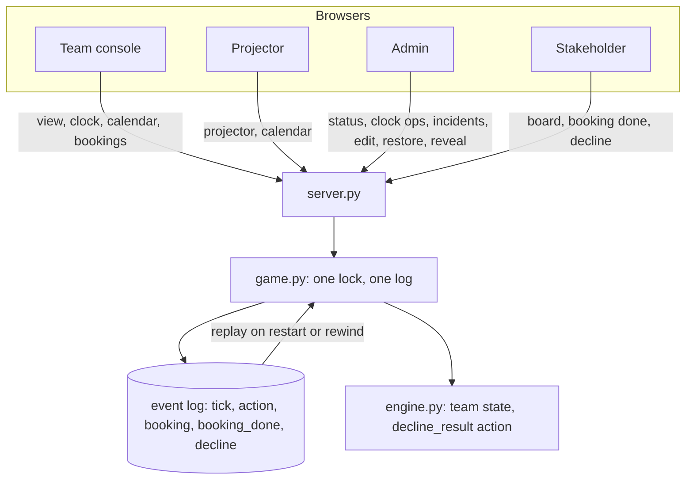

# Fix Forward Event Screens - Plan

## Goal Capsule

- **Objective:** The MC, the server operator, three stakeholders and the room can run the 4 December event from browsers, and a full 52-week game plays through to the final reveal over HTTP with scripted teams.
- **Means:** Four new screens (projector, admin, stakeholder) and console additions, built on the existing server and console, with stakeholder bookings kept as durable game state in the same event log (KTD1, KTD3, KTD6).
- **Authority:** `fix_forward_build_spec_v3.md` (sections 4.5, 7, 8, 9, 10.2, 12) wins on rules. `CLAUDE.md` hard constraints win on how: hidden values stay off team browsers, the engine stays deterministic, every number lives in config, time lives on the server, URLs are relative, and the committed `static/` build runs with Python only. This plan wins on how the screens are built.
- **Stop conditions:** Stop and report if any team-facing or stakeholder-facing response carries a hidden field name or a debt number, if a restart or snapshot restore loses or resurrects a booking, or if the full-game test cannot reach the reveal.
- **Execution profile:** Two PRs (see Implementation Units). Python standard library only at runtime; Node only to build the console.
- **Out of this stage:** the 20-client load test, the failure drill, spare-laptop replication, the emergency start from a bare snapshot, printed incident packets, the debrief charts (spec section 14), and any balance retuning.

---

## Product Contract

### Summary

Add what the event needs beyond the team console. A projector screen shows the live leaderboard, clock and checkpoint countdown, and the final reveal. An admin screen gives the operator every control the spec lists. The team console gains a calendar with the weeks 28 to 30 surge, an outage notice, and visible whale contract results. Stakeholders get their own screen for bookings, script cards, CTO traffic lights and the decline checklist, with teams booking from the console. A full-game test drives scripted teams over HTTP to the final reveal.

### Problem Frame

The engine already handles peak season and whale awards, and the server already has a projector feed and admin routes, but only a curl command can use the admin routes, no screen exists for the room, and teams have no way to book a stakeholder. The spec's build-plan done condition for this stage is a full 52-week game with scripted teams over HTTP. The admin screen appears in `CLAUDE.md` and spec section 10.2 but in no day of the build plan, so the operator would have nothing to run the dress rehearsal with. The stakeholder screen is the first item in the spec's cut order, so it is planned last and shipped separately.

### Key Decisions

- **The admin screen is built in this stage.** Governs R6. (session-settled: user-approved — chosen over leaving it for stage 7: the operator needs it for the 28 to 29 November dress rehearsal and the full-game test.)
- **The plan ships as two PRs: room and operator essentials first, the stakeholder system second.** Governs R10. (session-settled: user-approved — chosen over one PR: the stakeholder screen is first in the cut order and a rehearsal needs the projector sooner.)
- **Bookings are durable game state, logged like every other change.** Governs R8, R9. (session-settled: user-approved — chosen over in-memory bookings: a restart or snapshot restore must not lose or resurrect one.)
- **Stakeholders share one password, then pick their role.** Governs R12. (session-settled: user-approved — chosen over a password per role: three trusted staff on one event.)
- **Script card wording is editable data in config, drafted from the spec.** Governs R11. (session-settled: user-approved — chosen over text in screen code: the organiser owns the wording. The CTO traffic-light lines are drafted here because the spec names but does not write them.)
- **The decline checklist reuses the existing Whale-trust action.** Governs R13. (session-settled: user-approved — chosen over a new mechanic: three ticks give +5, two give 0, fewer give -5, already in config.)

### Requirements

**Room and operator**

- R1. The projector screen shows every team's live ARR and average trust ranked by ARR, the clock, the checkpoint countdown, and the surge weeks, and after the final reveal shows debt, valuation and the ranking by valuation. Before the reveal it carries no debt or valuation figure.
- R2. Every console shows a calendar of the game: checkpoints, the surge weeks 28 to 30, the whale contract application weeks and the current week, taken from config.
- R3. A team whose build capacity is seized by a peak-season outage sees that notice on its console, without any debt number.
- R4. A console shows a team's whale contract state: not yet open, open, applied, awarded, or not awarded after the window closes.
- R5. The projector and admin screens poll at the interval the clock block reports and display the server's clock, never their own.
- R6. The operator can pause, resume, extend, hold, override the countdown, change speed, trigger or cancel an incident for one team or all, edit a team's state with a logged reason, restore a snapshot, reload from the log, take a snapshot now, and trigger the final reveal, from one admin screen behind the admin password. It shows log health and snapshot age.
- R7. A scripted full game over HTTP runs all 52 weeks for several teams, reaches the reveal, and a restart from the log reproduces every team's state.

**Stakeholders**

- R8. A team can book a stakeholder from its console: each of the three stakeholders takes 5 bookings per quarter, first come, one per team per stakeholder per quarter, and the console shows what is left and the team's own bookings. A booking made in the break at the end of a quarter counts toward that quarter.
- R9. A stakeholder sees a first-come queue of bookings, can mark a meeting done, and sees the current quarter's script card for their role: what they say unprompted and what they say only if asked.
- R10. Whale lead sees, for the team in front of them, only these facts: whether data isolation has shipped, whether the team had a peak-season outage, and whether it applied for the bespoke contract.
- R11. The CTO screen shows every team's debt band as green, amber or red with the quarter's line for that band, and shows no debt number anywhere.
- R12. Stakeholder routes need the stakeholder password, every comparison is constant-time, and a wrong password gets the same answer for every route.
- R13. A stakeholder can enter the three-item decline checklist for a team once, and a repeat is refused.

### Success Criteria

- A scripted 8-team full game over HTTP finishes at the reveal and its restart-from-log digests match.
- During a three-team rehearsal quarter, the operator runs the clock only from the admin screen and the room follows on the projector.
- No stakeholder or team response contains a hidden field name or a debt figure.

### Scope Boundaries

**Deferred to Follow-Up Work**

- 20-client load test, failure drill, spare-laptop replication, emergency start from a bare snapshot (stage 7).
- Debrief charts and the reveal flow in spec section 14, beyond the projector's final ranking.
- A cut-back switch for the scored decline conversation. The spec's cut-back rule is decided after the dress rehearsal.

**Considered and not built**

- A password per stakeholder role: three staff share one password.
- A scheduler that assigns booking times: the spec says first come and in person, so the queue is order only.
- Eligibility rules for the decline checklist beyond once per team (see Open Questions).
- Browser end-to-end tests, as in the console plan.

---

## Planning Contract

### Key Technical Decisions

- KTD1. **Bookings, meetings done and decline entries are game-level events in the existing log, and replay rebuilds them.** Lines of kind `booking`, `booking_done` and `decline` join the `tick` and `action` lines, so a restart rebuilds the board from the log alone and a rewind (`store.effective_events`) drops later ones with no extra code. The decline itself is still the engine's `decline_result` action, logged as an action, so team state and replay digests are unchanged. The snapshot payload also carries the board so a later emergency start has it. (session-settled: user-approved — chosen over a separate bookings file: two files would need their own recovery and rewind rules.) Cited by U5.
- KTD2. **The calendar is a public route built from config.** `GET /api/calendar` returns checkpoint weeks, surge weeks, whale application weeks and quarter length; it holds no hidden value, so the same response serves consoles and the projector. Cited by U1, U2, U3.
- KTD3. **The team view gains one boolean, `outage`, true while outage rework is owed.** It tells a team capacity is seized without exposing the owed amount, which would reveal debt. The name avoids every entry in `HIDDEN_FIELD_NAMES`. Cited by U1.
- KTD4. **The stakeholder password travels in an `X-Stakeholder-Password` header and is compared with `hmac.compare_digest`, like the admin password.** The stakeholder password is already accepted at startup. A wrong or missing password returns the same 401 on every route, and role choice is a screen filter, not a permission. Cited by U5.
- KTD5. **The stakeholder board is built field by field, like `team_view`.** It carries a debt band computed from config thresholds, three booleans for the Whale lead, and booking order, and never a debt number, risk, lift or gain. A test fetches every stakeholder route and fails on a hidden field name. Cited by U5.
- KTD6. **The booking quarter is `ceil(day / days per quarter)`, with day 0 counting as quarter 1.** The break at the end of a quarter runs with the clock on that quarter's last day, so it counts toward that quarter. The helper lives in config beside the quarter constants. Cited by U5.
- KTD7. **Admin and stakeholder passwords live in `sessionStorage` after entry and are sent in the header.** A reload keeps the operator signed in for the browser session, and closing the tab forgets it. Cited by U4, U9.
- KTD8. **A shared stdlib HTTP game harness runs scripted strategies against a real server.** `httpgame.py` reads views and posts actions the way a browser does, one decision per game day, and is reused by the stage 7 load test. The full-game test starts the server in-process with a short seconds-per-day and a short checkpoint pause. Cited by U6.
- KTD9. **Each new screen is a Vite multi-page entry sharing the console's components and design tokens.** The projector and admin join `index.html` and `team.html` as entries; the stakeholder screen follows in the second PR. Cited by U3, U4, U9.

### High-Level Technical Design



### Output Structure

```text
httpgame.py                  stdlib HTTP harness for scripted full games
web/
  projector.html  admin.html  stakeholder.html     new entries
  src/pages/        projector.tsx  admin.tsx  stakeholder.tsx
  src/components/projector/  admin/  stakeholder/
  src/components/calendar.tsx  outage-notice.tsx  contract-panel.tsx  bookings.tsx
tests/
  test_calendar_view.py  test_full_game_http.py  test_stakeholders.py
```

### Risks and Dependencies

- Schedule. The three-team live quarter runs 24 to 26 November and the dress rehearsal 28 to 29 November. PR1 holds what a rehearsal needs. PR2 can slip past the 1 December freeze only as a cut, using paper cards and a sign-up board as the spec allows.
- A stale `static/` build. Every web unit rebuilds before committing, per `CLAUDE.md`.
- The decline conversation's timing is inconsistent in the spec (see Open Questions), so the checklist does not enforce a window.
- A log-format change. New event kinds must be ignored cleanly by older replay code; the plan adds them in one place and tests rewind and restart.
- Unmeasured: how many stakeholder polls a full room makes. Three stakeholders poll a small board, so it is not a risk, and the stage 7 load test covers the rest.

---

## Implementation Units

### PR1: Room and operator essentials

#### U1. Calendar route and outage flag

- **Goal:** Consoles and the projector can show the game's calendar, and a team can see an outage without a debt number.
- **Requirements:** R2, R3. Governed by KTD2, KTD3.
- **Dependencies:** none.
- **Files:** `config.py`, `server.py`, `engine.py`, `game.py`, `tests/test_calendar_view.py`, `tests/test_server.py`.
- **Approach:**
  1. Add `GET /api/calendar` (public) returning checkpoint weeks, `PEAK_START_WEEK`, `PEAK_END_WEEK`, the B1 application weeks and `WEEKS_PER_QUARTER` from config.
  2. Add `outage` to `engine.team_view`, true while `rework_owed` is above the float tolerance.
  3. Keep both out of the config digest unless they change a game rule: the calendar is derived from existing keys, so no new key is needed.
- **Patterns to follow:** the `/api/clock` route and `team_view`'s field-by-field construction.
- **Test scenarios:**
  - `GET /api/calendar` returns the surge weeks and checkpoints from config, and changing `PEAK_START_WEEK` in an overridden config changes the response.
  - The calendar response contains no key from `HIDDEN_FIELD_NAMES`.
  - A team with debt above the threshold at the start of week 28 has `outage: true` in its view, and it turns false once the rework is paid.
  - A team at or below the threshold never has `outage` true, and its view contains no owed amount.
  - The existing hidden-field test over team endpoints still passes with the new field.
- **Verification:** server and view tests pass and the hidden-field tests stay green.

#### U2. Console calendar, outage notice and whale contract panel

- **Goal:** A team sees where the game is, whether it is in an outage, and what happened to its whale contract.
- **Requirements:** R2, R3, R4. Governed by KTD2.
- **Dependencies:** U1.
- **Files:** `web/src/components/calendar.tsx`, `web/src/components/outage-notice.tsx`, `web/src/components/contract-panel.tsx`, `web/src/pages/team.tsx`, `web/src/lib/api.ts`, `web/src/lib/types.ts`, `web/src/lib/contract.ts`, `web/src/lib/contract.test.ts`, `static/` (rebuilt).
- **Approach:**
  1. Fetch the calendar once and draw a 52-week strip on the Overview tab: quarters, checkpoints, the surge band, the application window, and the current week from the clock block.
  2. Show a banner when the view's `outage` is true.
  3. Derive the contract state from `view.b1`, the clock's week and the calendar window in a pure helper, and show it in a panel on the Roadmap tab.
- **Patterns to follow:** `ClockBar`, `IncidentAlert`, and the pure helpers in `web/src/lib/queue.ts`.
- **Test scenarios:**
  - Before the application window the contract state is "not yet open", inside it without an application it is "open", and with an application it is "applied".
  - After the window closes, an applied team that was awarded shows "awarded" and one that was not shows "not awarded".
  - A team that never applied shows "not awarded" once the window has closed.
  - The calendar marks the surge weeks 28 to 30 and the current week from the clock.
- **Verification:** the console build is clean and the three states render in the browser pane against a fast server.

#### U3. Projector screen

- **Goal:** The room can follow the game and the final reveal on one screen.
- **Requirements:** R1, R5. Governed by KTD2, KTD8, KTD9.
- **Dependencies:** U1.
- **Files:** `web/projector.html`, `web/src/pages/projector.tsx`, `web/src/components/projector/leaderboard.tsx`, `web/src/components/projector/header.tsx`, `web/src/lib/projector.ts`, `web/src/lib/projector.test.ts`, `web/vite.config.ts`, `static/` (rebuilt).
- **Approach:**
  1. Add a projector entry that polls `/api/projector` at `projector_poll_seconds` from its own clock block, with the same stale-view and reconnect handling as the console.
  2. Draw a ranked leaderboard for large type: ARR as a bar, average trust as a second figure, a rank change cue, and a surge-week banner from the calendar.
  3. Show a header with week, quarter, run state and the checkpoint countdown, shared with the console's formatting helpers.
  4. After `revealed`, switch the ranking to valuation and add debt and penalty columns from the feed.
- **Patterns to follow:** `ClockBar` and `useGame`'s polling shape in `web/src/lib`.
- **Execution note:** Mostly presentation; verify in the browser at 1920 by 1080 as well as a laptop width.
- **Test scenarios:**
  - Rows sort by ARR before the reveal and by valuation after, and a tie keeps team order.
  - A feed with no debt or valuation fields renders without them.
  - A feed with `revealed: true` shows debt and valuation columns.
  - A rank change between polls produces an up or down cue and no cue on the first poll.
  - The poll interval follows the clock block.
- **Verification:** the projector renders live against a fast three-team server and reveals correctly after the admin reveal route.

#### U4. Admin screen

- **Goal:** The operator controls the whole game from a browser.
- **Requirements:** R5, R6. Governed by KTD7, KTD9.
- **Dependencies:** none (uses existing routes).
- **Files:** `web/admin.html`, `web/src/pages/admin.tsx`, `web/src/components/admin/clock-controls.tsx`, `web/src/components/admin/incident-controls.tsx`, `web/src/components/admin/team-table.tsx`, `web/src/components/admin/edit-state.tsx`, `web/src/components/admin/snapshots.tsx`, `web/src/components/admin/reveal.tsx`, `web/src/lib/admin-api.ts`, `web/src/lib/admin-api.test.ts`, `web/vite.config.ts`, `static/` (rebuilt).
- **Approach:**
  1. Add a password gate that checks the password with `GET /api/admin/status`, stores it in `sessionStorage`, and sends it as `X-Admin-Password`.
  2. Show clock state and controls (pause, resume, extend, hold, countdown override, speed from the configured choices), log health, snapshot age and warnings, and the team list with codes.
  3. Add incident trigger and cancel for one team or all, an edit-state form that requires a reason, a snapshot list with restore and a confirmation, reload from the log, snapshot now, and a reveal button behind a confirmation.
  4. Mark destructive actions (restore, reveal, edit) with a confirm dialog that names the effect.
- **Patterns to follow:** `createApi` in `web/src/lib/api.ts` for typed results, and the dialogs in `web/src/components/queue.tsx`.
- **Test scenarios:**
  - A wrong password stays on the gate with a message and stores nothing.
  - A correct password stores it for the session and sends it in the header on later calls.
  - Each clock operation posts the right body, and a rejected operation shows the server's message.
  - An edit without a reason is not sent.
  - Restore and reveal send nothing until confirmed.
  - A 401 mid-session returns to the gate.
- **Verification:** from the screen alone, start a fast game, pause, change speed, trigger and cancel an incident, take a snapshot, restore it, and reveal.

#### U6. Full-game HTTP harness and test

- **Goal:** The spec's done condition: a full game with scripted teams over HTTP, restartable from the log.
- **Requirements:** R7. Governed by KTD8.
- **Dependencies:** U1 (the harness reads the new view field).
- **Files:** `httpgame.py`, `tests/test_full_game_http.py`, `tests/gamehelpers.py`.
- **Approach:**
  1. Write `httpgame.py` with a stdlib client that polls the clock, fetches each team's view (with slices when a strategy asks), runs a strategy from `bots.py`, and posts its actions, once per game day.
  2. Write a test that starts the server in-process with a short seconds-per-day and a short checkpoint pause, runs eight teams to the end, calls the reveal route, and checks the projector feed.
  3. Stop the server, start a new one over the same state directory, and compare per-team digests.
- **Execution note:** Prefer a few seconds of wall time per game; the existing kill test already runs a real process, so keep this one in-process.
- **Patterns to follow:** `tests/test_server.py` server setup and `tests/test_kill_restart.py`.
- **Test scenarios:**
  - Eight scripted teams reach day 364 with `finished` true and the reveal makes the projector feed carry valuation.
  - No action posted by a strategy is rejected for a reason other than a game rule.
  - Restarting from the log gives identical state digests for every team.
  - The final ranking by valuation matches `engine.score` run on the replayed states.
  - A team's action posted on the day of a checkpoint pause is accepted.
- **Verification:** the test passes repeatedly and the harness runs as a script for a few teams from the command line.

**PR1 ships U1 to U4 and U6.** It holds everything a rehearsal needs. U6 depends on U1 only.

### PR2: Stakeholder system

Waits on: PR1, merge order only. The stakeholder screen is first in the spec's cut order and nothing in PR1 depends on it, so it ships separately and can be cut without touching PR1.

#### U5. Stakeholder state, routes and auth

- **Goal:** The server keeps bookings, meetings done and decline entries durably and serves the stakeholder board safely.
- **Requirements:** R8, R9, R10, R11, R12, R13. Governed by KTD1, KTD4, KTD5, KTD6.
- **Dependencies:** none (PR1 is a merge-order wait only).
- **Files:** `config.py`, `game.py`, `server.py`, `store.py`, `tests/test_stakeholders.py`, `tests/test_recovery.py`.
- **Approach:**
  1. Add config: the three roles, bookings per stakeholder per quarter, debt band thresholds, and the booking-quarter helper.
  2. Add game-level methods under the existing lock: `book(team, role)`, `mark_done(booking)`, `decline(team, ticks)`. Each validates, appends its log line, and bumps a board version. `decline` applies the existing `decline_result` action and refuses a second entry for a team.
  3. Teach `_replay` and `_adopt` the three new event kinds, include the board in the snapshot payload, and clear it correctly on rewind.
  4. Add routes: team `GET` and `POST /api/team/<code>/bookings`; stakeholder `GET /api/stakeholder/board`, `POST /api/stakeholder/done`, `POST /api/stakeholder/decline`, all behind the stakeholder password header.
  5. Build the board from `team_view`-style allow-listed fields: bookings in order with team name, the CTO band per team, and three Whale-lead booleans per team.
- **Patterns to follow:** `Game.submit`, `store.effective_events`, the admin route auth in `server.py`.
- **Test scenarios:**
  - The sixth team to book a stakeholder in a quarter is refused and the first five are kept in order.
  - A team cannot book the same stakeholder twice in a quarter but can in the next.
  - A booking at day 91 (the break after quarter 1) counts toward quarter 1, and at day 92 toward quarter 2.
  - Restarting from the log rebuilds the same board, including a meeting marked done.
  - A snapshot restore that rewinds past a booking drops it, and one that does not keep it.
  - A second decline entry for a team is refused and Whale trust moves once, by +5, 0 or -5 for 3, 2 or fewer ticks.
  - A missing or wrong stakeholder password gets the same 401 on every stakeholder route, and the admin password does not open them.
  - Every stakeholder and booking response contains no key from `HIDDEN_FIELD_NAMES` and no debt number; the CTO band is green at 15, amber at 16 and red at 31.
  - The Whale-lead booleans change when data isolation ships, when an outage occurs, and when the team applies.
- **Verification:** the new tests pass with the existing recovery and kill tests.

#### U7. Script cards and CTO lines as config data

- **Goal:** The four quarters' script cards, the traffic-light lines and the Whale lead's conditional lines are editable data the organiser can rewrite.
- **Requirements:** R9, R10, R11. Governed by the Key Decision on script cards.
- **Dependencies:** U5.
- **Files:** `config.py`, `tests/test_stakeholders.py`.
- **Approach:**
  1. Add `SCRIPT_CARDS` keyed by quarter and role with `unprompted`, a list of question and answer pairs, and for the Whale lead the conditional lines with the board boolean each one reads. Fill them from spec section 9.2.
  2. Draft the CTO's green, amber and red lines and the quarter 4 audit line, marked as first drafts for the organiser.
  3. Serve the current quarter's cards with the board.
- **Patterns to follow:** the alert text in `config.ALERTS`.
- **Test scenarios:**
  - Every quarter has all three roles, each with unprompted text and at least one question and answer pair.
  - No card text contains a debt number, a risk number or a utility score.
  - The Whale lead's quarter 3 conditional line appears only when its boolean is true.
  - The CTO line returned for a team matches its band.
- **Verification:** the board for each quarter lists the right cards.

#### U8. Console stakeholder booking

- **Goal:** A team can book a stakeholder and see what is left.
- **Requirements:** R8. Governed by KTD6.
- **Dependencies:** U5.
- **Files:** `web/src/components/bookings.tsx`, `web/src/pages/team.tsx`, `web/src/lib/api.ts`, `web/src/lib/bookings.ts`, `web/src/lib/bookings.test.ts`, `static/` (rebuilt).
- **Approach:**
  1. Add a Stakeholders tab listing the three stakeholders with places left this quarter, a Book button, and the team's own bookings with queue position.
  2. Refetch bookings at a multiple of the poll interval and after any booking.
  3. Show the server's refusal (full, already booked) in a toast.
- **Patterns to follow:** `ActionsProvider` and `useWindowView`.
- **Test scenarios:**
  - A stakeholder with no places left shows full and no Book button.
  - A stakeholder the team already booked this quarter shows the booking and queue position, and no Book button.
  - A refused booking shows the server's message and leaves the list unchanged.
  - Places left reset when the quarter changes.
- **Verification:** two consoles book against a fast server and see the counts fall.

#### U9. Stakeholder screen

- **Goal:** Stakeholders run their queues and scripts from one screen.
- **Requirements:** R9, R10, R11, R13. Governed by KTD4, KTD5, KTD7, KTD9.
- **Dependencies:** U5, U7.
- **Files:** `web/stakeholder.html`, `web/src/pages/stakeholder.tsx`, `web/src/components/stakeholder/queue.tsx`, `web/src/components/stakeholder/script-card.tsx`, `web/src/components/stakeholder/cto-lights.tsx`, `web/src/components/stakeholder/decline.tsx`, `web/src/lib/stakeholder-api.ts`, `web/src/lib/stakeholder-api.test.ts`, `web/vite.config.ts`, `static/` (rebuilt).
- **Approach:**
  1. Add a password gate and a role picker. The picker changes what the screen leads with and nothing else.
  2. Show the booking queue in order with a Met button, the current quarter's script card for the role, and for the Whale lead the three facts for the team being met.
  3. Show the CTO's table of teams with band colours and the quarter's line for each band, refreshed live.
  4. Show the decline checklist: pick a team, tick the three items, and send; a repeat shows the server's refusal.
- **Patterns to follow:** the admin gate from U4 and `Queue` for ordered lists.
- **Test scenarios:**
  - A wrong password stays on the gate, and a 401 mid-session returns to it.
  - Marking a meeting done sends the booking id and removes it from the queue after the refetch.
  - The decline form sends the tick count, not the individual ticks, and a second entry shows the refusal.
  - The CTO table renders only band colours and lines, with no number from the feed that looks like debt.
  - The Whale lead sees three yes or no facts and nothing else about the team.
- **Verification:** a fast three-team game with a booking, a meeting done, a decline entry and a CTO table, all from the browser.

---

## Verification Contract

| Check | Command or procedure | Applies to |
| :--- | :--- | :--- |
| Python suite | `uv run python -m unittest discover -s tests` | all units |
| Full-game test | `uv run python -m unittest discover -s tests -p "test_full_game_http.py"` | U6 |
| Console type check | `npm --prefix web run typecheck` | web units |
| Console tests | `npm --prefix web run test` | web units |
| Production build | `npm --prefix web run build`, then commit `static/` | web units |
| Rehearsal run | `uv run python server.py --teams 3 --seconds-per-day 0.5 --new-game`, drive from the admin screen, watch the projector, book and decline from the screens | U3, U4, U8, U9 |
| No hidden fields | the existing endpoint tests plus the new stakeholder and calendar tests | R10, R11, R12 |

## Definition of Done

- U1 to U4 and U6 merged in PR1, U5 and U7 to U9 in PR2, each with its verification met.
- The full-game test passes and the rehearsal run works from the admin screen alone.
- `DECISIONS.md` Part 2 records the booking rule, the quarter helper, the decline rule, the script card drafts and the new view field, and `static/` holds a fresh build.
- Abandoned experiments and stray scaffold files are removed from the diff.

## Open Questions

### Deferred to the organiser

- **The decline conversation's timing.** Spec 9.1 puts it in checkpoint 1 (end of week 13) for teams that do not apply for the bespoke contract, but the application window is weeks 14 to 17, after that checkpoint. The plan does not enforce a window or an eligibility rule beyond once per team. Which checkpoint is meant?
- **Script card wording.** The cards come from spec 9.2, and the CTO's traffic-light lines are first drafts to rewrite.
- **One booking per team per stakeholder per quarter.** The spec says five bookings per stakeholder per quarter and says nothing about repeats. The plan allows one.

### Deferred to implementation

- How the projector shows a rank change and what the surge banner says.
- Whether the stakeholder screen refetches on a fixed interval or the clock's poll interval.

---

## Sources and Research

- Existing hooks: `game.py` (`submit`, `_tick`, `_replay`, `projector`, `snapshot_now`), `server.py` (routes, admin auth, static handling), `engine.py` (`team_view`, peak-season block near line 338, `resolve_b1_awards`, `decline_result`), `config.py` (`PEAK_*`, `B1_*`, `DECLINE_*`, `ALERTS`, `ACTION_SPECS`, `CALLER_ACTIONS`), `store.py` (`effective_events`).
- Spec sections 4.5, 7, 8, 9, 10.2, 12 and 14 in `fix_forward_build_spec_v3.md`.
- Console plan: `docs/plans/2026-11-23-1228-feat-team-console-plan.md` and the merged PRs #3 and #4 for the web patterns reused here.
- The admin screen's gap: `CLAUDE.md` lists it as required and spec section 10.2 lists it as a screen, but no day in spec section 12 builds it.
